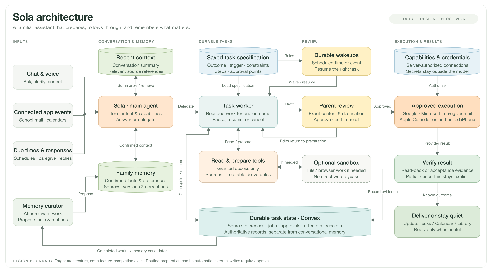

# Daymark — MVP build spec

Version 24 · Updated October 19, 2026 · Current build spec

**Status:** Authoritative MVP implementation contract. This document specifies required behavior; README records what is implemented and verified.

## Current decisions

Keep the three outcomes below. Retain React/Capacitor for iPhone, Vercel for browser previews and response pages, Convex for canonical connected records and durable workflows, Auth0 for connected identity, and provider-specific calendar/email integrations. Add Sola's conversation coordinator and bounded task workers over these foundations. Google is the existing first adapter, not a requirement for using Daymark. Apple Calendar/iCloud on iPhone and Outlook/Microsoft 365 email/calendar remain required targets. Preserve the model adapter; select Claude Sonnet 5.5 at medium effort for the initial connected text pilot, with initial synthetic live evaluation completed and broader acceptance still pending. Optional voice uses OpenAI Realtime with explicit consent; the owner confirms hosted microphone input, live captions, spoken replies and follow-up conversation; the owner also confirms physical-iPhone live voice after native sign-in; the owner confirms mute/unmute, audio and foreground-exit microphone shutdown; broader phone-call/headset/audio-routing acceptance remains open. Future task-specific model routing remains open. **An execution sandbox is optional and deferred; no E2B, Daytona or Composio service is selected or provisioned.**

**Current implementation — October 19:** The matched hosted pilot includes model-selected conversation/read tools, versioned saved-work management, private tasks, reviewed memory/routines, consented attachments and private calendar assistance. The main conversation carries requests, prepared work and receipt-backed updates; Tasks returns there before explicit review. A compact pinned header keeps Settings and History reachable while messages scroll. Settings use compact groups with detail on demand; voice controls remain inline and the processing disclosure is remembered on this device for the same adult/backend/mode. An explicit microphone tap and OS permission remain necessary. Provider writes require exact, current approval, durable dispatch and read-back. Credentials remain outside model context.

Actual dedicated-account synthetic acceptance now passes for Gmail draft creation, same-ID editing, separately approved sending and exact SENT-copy verification, including the original conversation after Gmail reformatted an opened draft. A useful new-message check also ran with Sola closed and the local backend stopped. Google Calendar passes create, same-ID time update, Google-side location change read back, deletion and final empty selected-calendar read. A Gmail caregiver invitation passed exact SENT verification; the independently signed-in assigned caregiver accepted and the parent received a separate agreement receipt. No reminder or calendar effect was enabled; caregiver agreement does not prove pickup completion. The owner confirms hosted voice microphone input, live captions, spoken replies and a follow-up conversation. These proofs are scoped tests, not general parent/pilot acceptance.

Private Gmail replies retain server-owned thread/parent/reference/subject routing; models and clients cannot choose hidden headers. Recovery is bounded and read-only without replay. Same-account permission renewal preserves the mailbox ID, private history, drafts/receipts, cursors and budgets; old write approvals remain stale. Explicit removal, account replacement and changed processing windows retain separate behavior. An earlier permission refresh erased older Sola copies under the previous replacement behavior; Gmail messages were unaffected, and erased copies are not restored by the fix.

Caregiver delivery binds the approving parent's exact account, recipient and invitation. Response links are encrypted at rest; dispatch is journaled once, current eligibility is checked immediately before sending, and ambiguous results reconcile read-only. A verified Auth0 identity must match the assigned caregiver. First-time caregivers can use the existing Google identity connection or the email signup/verification alternative, without a household or installed app. This is authenticated access, not anonymous access. Legacy Resend code/in-app paths remain compatible. Native startup restores through the SDK's public silent-token API and Keychain cache, with finite expiry, revocation and failure guards; the owner now confirms physical connected-session recovery after closing/reopening the app. Expiry/revocation and broader recovery acceptance remain open.

**Current development focus:** Validate the deployed context/work-management and simplified interface in daily use, with broader follow-up, ambiguity, relevance and two-adult acceptance; finish the native interface update, integrated Share/EventKit/provider execution and phone-call/headset/audio-routing checks. Pause/revoke/reconnect and interruption remain release gates. The October 19 retained-simulator retry again raised Mac load from about 6 to 130; only that test device was stopped, without erasing data. Signed simulator compilation and actual physical App/Share signing/provisioning/installation pass. Developer Mode and owner developer trust are enabled; exact-device launch passes. The Personal Team test build preserves the shared container and omits optional APNs only through a command override; production entitlements remain intact. Installation does not prove runtime/native acceptance. The [build checkpoints](#build-checkpoints), README and progress diagram hold the current release identity and verification. Implementation and synthetic checks never replace provider or physical-device acceptance.

**October 1 architecture decision:** Adopt the main-agent/task-worker pattern discussed from the user-supplied Instinct diagram, with separate conversation context, confirmed family memory, versioned task specifications and authoritative execution records. Explicit approval and result verification sit in the execution path. Keep credentials outside model context and ordinary sandbox access. The [Sola architecture diagram](#sola-architecture) and runtime flow below define the component contract; the implementation/acceptance section and marked progress diagram record which parts are built and verified.

**September 30 direction (subsequently resumed):** The user initially deferred completing and live-verifying the three connected outcomes while considering the backend. Development and scoped live verification have since resumed as recorded above. Develop the product toward a more personal, conversational and proactive Sola: grounded capability answers, permitted email/calendar monitoring, reusable workflows, speech-to-text and live voice, and Calendar replacing the Plan destination. The section below records the requested behavior, research and open backend decisions. These are requirements under development, not shipped capabilities; deferring verification does not waive the eventual release criteria.

**No account is required to use the local MVP.** The normal homepage opens a device workspace when signed out or cloud configuration is absent. Users can save family details, submit notices, review and edit drafts, save a device plan, download calendar files, and copy email/pickup text. Auth0 remains optional for the separate connected household and its server workflows; this does not make authenticated Convex records public. The three external outcomes below remain the connected MVP's release criteria, and are never claimed by a local save or copy.

The stack review below records the retained foundation; the architecture extends it without a backend migration. The hosted pilot and its checks are recorded below; production release still requires service, cost and native acceptance. Use dedicated test accounts and synthetic fixtures for unfinished integrations. Current progress and the next action live in the repository README; completed changes and decisions live in CHANGELOG.md.

### Stack review

| Decision | Why it fits | Tradeoff / alternative considered |
|---|---|---|
| Keep Convex | TypeScript backend, live UI updates, persisted jobs and workflow steps fit our request/approval/response loop | Convex-specific data/functions create migration work later; keep business validation separate and test exports. Supabase/Postgres provides a durable queue and greater SQL portability, but we would still implement the consumer/workflow behavior. |
| Provider-specific adapters | Keep the existing Google adapter; add Apple EventKit on iPhone and Microsoft Graph for Outlook mail/calendar behind shared approval and receipt contracts | Each needs its own permission, retry, and verification behavior. Composio remains deferred pending a concrete benefit; it cannot replace native calendar permissions or approval enforcement. |
| Defer execution sandbox | The three core outcomes use direct provider APIs and native EventKit; they do not require an agent computer | E2B or Daytona can be evaluated for a specific file/browser workflow later. A leased sandbox does not own durable tasks, credentials or approvals. |
| Keep Vercel + Capacitor | Reuse the existing interface and get preview links without a client rewrite | Vercel is optional hosting convenience, not the iOS runtime. Native verification and TestFlight remain separate. |

Basis: [Convex workflow](https://www.convex.dev/components/workflow), [Supabase queues](https://supabase.com/docs/guides/queues), [Google Gmail send](https://developers.google.com/workspace/gmail/api/reference/rest/v1/users.messages/send), [Calendar scopes](https://developers.google.com/workspace/calendar/api/auth), [Composio custom auth](https://docs.composio.dev/docs/auth-configuration/custom-auth-configs), [Daytona sandboxes](https://www.daytona.io/docs/en/sandboxes/).

Caregiver email can reuse the approving parent’s selected Gmail account when sending and read-back permissions are enabled. Review binds the sender, recipient, message, scoped response URL and optional single reminder; an independent verified Auth0 caregiver identity controls the response. A parent-visible Sent link must never double as caregiver verification. Legacy Resend delivery with mailbox verification codes remains available when separately configured; inbound forwarding still needs its own verified provider setup. No additional sending service is provisioned.

Cost is not yet benchmarked. Convex has plan limits and metered resources; Composio adds its own tool-call accounting when used. Measure model, backend, email, and storage cost on the first real workflow before selecting paid capacity. No recurring service is added just because it appeared in a demo. [Convex pricing](https://www.convex.dev/pricing), [Composio pricing](https://landing.composio.dev/pricing)

Keep Riley Brown's build–test–fix approach: implement a usable outcome, exercise it, inspect the actual result, and repair it. His [post](https://x.com/rileybrown/status/2102252318448058464) describes a prototype; it does not establish production reliability.

## 1. Product

**Daymark is a personal household assistant. Sola helps parents keep family life organized, notices what needs attention with their permission, prepares the work, asks for approval, carries out supported actions, and confirms the result.**

First users: parents managing two or more elementary- or middle-school children, with messages, activities, and pickups spread across several sources. Single parents and families with different caregiver arrangements are included. A second adult is optional.

The wider product includes family and parent events, field trips, household to-dos, important details missed in email, calendar coordination and future help finding or buying needed items. Elaine, a mother coordinating three children’s activities and commitments, is the motivating user: help her carry less of the coordination work herself. School is an important starting point within that household role.

The first release proves three connected jobs:

1. **Update the family calendar from school messages.**
2. **Arrange pickups and get an explicit answer from the caregiver.**
3. **Write and send routine school replies.**

The value is fewer minutes spent reading, copying, composing, and chasing answers. Count completed work and parent effort saved, not conversations, reminders, or time in the app.

**Name:** Daymark. A practical, understated working name for the household agent. Domain, App Store, and trademark clearance remain separate launch tasks; this is not a claim of name availability.

## 2. The core experience

**Share or ask → Daymark prepares → parent reviews → Daymark executes → result recorded.**

Example: a parent shares an early-dismissal notice and types, “Handle this. Ask Alex about pickup.”

- Daymark identifies the child, date, dismissal time, and school from the notice and saved family context.
- It finds the existing pickup event and prepares a time change instead of adding a duplicate.
- It prepares a request to Alex with the exact child, time, and location.
- The parent sees the calendar change and outgoing request together, edits if needed, then approves.
- Daymark updates the calendar, sends the request, and waits for Alex's response.
- Alex accepts through a private link without installing the app. Daymark records the arrangement and updates the pickup event's responsibility field.
- If Alex declines or the response deadline passes, Daymark prepares the next option using approved household contacts and asks the parent to choose.

“Request sent,” “Alex accepted,” and “Pickup happened” are different facts. The app must never treat them as equivalent.

### Personal assistant development direction

Recorded September 30, 2026. The user wants Sola to feel like a familiar second pair of hands for parents, with natural conversation and useful initiative. Keep the three core outcomes as the initial execution skills, while supporting conversation, personal tasks and preparation across household life. Do not force every conversational turn into a task or calendar form.

#### Tone and conversation

Sola should sound warm, calm, capable and concise. Use ordinary speech and contractions, acknowledge what the parent needs, and move toward a useful result. Respond briefly when the parent is rushed; explain more when asked. Use confirmed family names naturally, without repeating the parent's name in every reply. Avoid corporate support language, excessive enthusiasm, parenting judgments, guilt, and invented familiarity. The personal character stays recognizably AI; it does not require a fabricated human biography.

Create a shared voice/tone policy for greetings, model conversation, clarifications, draft introductions, progress, errors and spoken replies. The outgoing school email has its own audience and tone; Sola's chat personality should not leak into a formal message. Support an editable preference for shorter or more detailed replies without adding mandatory onboarding.

Common instruction for the conversation path, with live quality evaluation still required:

> You are Sola, the household's AI assistant in Daymark. Speak like a thoughtful, practical assistant who respects a busy parent's time. Lead with the useful answer or the work you prepared. Use confirmed context and the current capability and task records. Ask one compact question when something necessary is missing. Offer a sensible next step. Describe only work you actually did, and distinguish prepared, approved, waiting, sent and verified. Use a warm, natural voice without exaggerated affection or praise.

Synthetic examples of the intended tone:

| Situation | Example reply, only when its facts are true |
|---|---|
| Missing pickup detail | “I can prepare that. Who should I ask about Maya's pickup?” |
| Work ready | “I've drafted the reply. I kept the reason out, as you asked.” |
| Confirmed scan found a change | “School moved dismissal to 1 p.m. I've prepared the calendar change and a pickup request for you to review.” |
| Missing connection | “I can draft the reply now. Connect Outlook when you're ready for me to send it after your approval.” |
| Uncertain send | “I couldn't confirm whether the email went through. I'll check its status before trying again.” |

The connected coordinator uses the model for conversation and saved-work questions when configured. Atomic explicit task creation, greetings and capability replies retain their efficient direct paths; their acknowledgments now remain in follow-up history. Without a model, device/saved-state help remains limited and truthful. Ordinary household suggestions should be useful without repeatedly demanding a connector or a new task.

Recent context includes prepared-work introductions and valid recorded results. After an unrelated family-state change invalidates an answer, the same adult's original unexpired words can still supply the topic; the stale answer cannot. Changed permissions, expiry and private-source boundaries remain authoritative. Automatic background mail checks cannot take over an unrelated conversational follow-up. Context remains bounded, not permanent or exhaustive memory.

Connected `read_work` and `manage_work` let the model choose an existing task or request, then the server checks current identity, exact parent intent, unique target, versions and execution state. Parents can edit/finish/reopen/remove tasks, revise a draft, cancel pending Sola work or hide a request. Bare references resolve only when unambiguous. Quoted/reporting instructions cannot authorize a change; active or uncertain provider operations block it. Request revision clears prior approval. Hiding/cancellation preserves provider receipts and never undoes a sent message, event or caregiver agreement. Results are authored from the committed state, not the model's completion claim.

Six actual-model conversation/tool-selection evaluations pass. A fresh isolated Convex backend also passes a 17-model-call lifecycle: dinner follow-up, task creation/rename/completion/removal and request preparation/revision/cancellation/hiding, with separate-identity rejection and zero provider connections, approvals, attempts or receipts. These are synthetic cases, not broad parent acceptance. Validate tone with parents; a fluent voice is not evidence of reliability. The design follows the HAX emphasis on understandable capabilities, contextual timing, correction and control; this is our application of that guidance, not a validated preference ranking for Sola. [Microsoft human–AI interaction guidelines](https://www.microsoft.com/en-us/haxtoolkit/ai-guidelines/)

#### Capability questions and missing connectors

Handle “What can you do?”, “Can you read my school email?”, “What are you handling for me?” and specific capability questions naturally. Answer from the current account's capabilities and actual job records, distinguishing available now, available after connection/permission, requiring the iPhone, and unsupported. Give a few relevant examples and a direct next action; avoid reciting a long tool catalog. The implemented shared inventory covers current task/draft/library features, scheduling, Google/Microsoft permissions, selected accounts and native Apple availability. Saved-state answers are refreshed on each request and explicitly exclude unscanned email and unsynced calendars. Large bounded contexts must disclose incomplete coverage instead of claiming an all-clear. Model credentials do not make unsupported tools available.

Maintain a server-validated capability inventory: supported action, connected account, granted read/write scopes, execution location, approval requirements and availability. Add last successful sync when connector watches exist; no timestamp should imply a scan that has not run. A model must not advertise an integration simply because it knows that service exists. If access is missing, save prepared work and offer the existing connection flow. If no adapter exists, allow the parent to save a connector request identifying the service and desired job, with a truthful manual fallback. Recording a request is not installing or connecting it. New adapters require implementation and verification; access grants remain explicit.

#### Proactive preparation

Proactivity is a priority: once the parent enables a clearly described watch, Sola should find relevant work in permitted school mail, selected calendars and supported future connectors. Useful triggers include a changed dismissal time, an unanswered school request, an approaching permission deadline, a pickup conflict, or the next occurrence of a saved routine. Read and prepare within that watch without requiring a fresh prompt every time.

- Let the parent choose accounts, folders/labels or school senders, calendars, useful time range and kinds of help. Explain what is read and retained. A folder or label filter limits Daymark's processing; it does not necessarily narrow the provider's OAuth permission.
- Treat provider change notifications as wakeups. Fetch changes, deduplicate sources, evaluate relevance and prepare bounded work; add scheduled catch-up checks for missed changes. Do not run a model continuously or repeatedly scan an entire mailbox.
- Show the source, why the item matters, and when the account was last checked. Prepare actual drafts or calendar changes, not a generic advice feed. Group related work and suppress repeated suggestions about the same source/revision.
- Let parents dismiss, snooze or disable a watch. Respect quiet hours and existing notification rules. Revoked access or stale data must stop claims that Sola is watching successfully.
- External content remains untrusted reference data. A message cannot grant new permissions, change an approval policy, or tell Sola to send family information elsewhere. Monitoring permission is separate from sending permission and from household sharing.

#### Inbox-wide personal email assistance — October 6 direction

The user clarified that Sola should connect to their home Gmail once, review the inbox across all senders, answer requests such as “Check my email” and “What did I miss?”, and proactively prepare useful follow-ups. A mandatory exact-sender list does not meet this goal. The private inbox implementation described here is now built and locally tested; real identity/OAuth, private source retrieval and a source-grounded model summary are now verified; broader connector acceptance remains pending. The earlier selected-sender implementation below is retained for compatibility and is no longer the main settings interface. Enabling private inbox assistance pauses it; existing watches never silently acquire broader processing consent.

**Minimal product interface.** The user explicitly rejected the sender-list/watch-activity interface. Present one Gmail connection row in Connections, with OAuth sign-in and a concise private-processing consent. Reading, searches, summaries and useful follow-ups belong in Sola’s existing conversation. Do not add a separate inbox dashboard, compulsory sender list, date-range setup, relevance explanations or routine check-ins. Show collapsed source detail and brief, truthful coverage when needed. Pause/history removal can sit under More; disconnect must really revoke the Google connection, with a clear note if it also supplies other Google features. Backend guardrails, durable progress and bounded usage remain required even when their machinery is absent from the main UI.

**Build privacy first.** Add an adult-owned mailbox review store, separate from shared household sources/jobs. Raw messages, summaries, evidence, search results, conversation references and suggested responsibilities remain visible only to the connecting adult. Enforce that boundary in every query, worker, model context, notification, export and deletion path; filtering only the UI is insufficient. Reuse the existing connection ownership, encrypted credential handling, source expiry and revocation checks. Promoting a specific email-derived item into household work requires a preview of what will be shared and an explicit parent decision; sharing does not approve external execution. Do not bulk-import private messages into the current household-visible job engine.

**Connect and check naturally.** Replace the compulsory sender setup with a clear inbox-reading consent and optional exclusions. The existing Google `gmail.readonly` grant supports this; no browser, mailbox password or sending grant is required. Expose server-validated check/search requests through the existing chat composer, with private run state, source detail and successful coverage. “Check my email” is the direct check action; a second dashboard is unnecessary. It starts a durable read run, not a model claim that the inbox has already been checked; an active check preserves its progress and must finish or continue before another starts. Validate requests and account access on the server; email content cannot change filters, permissions or approval rules.

**Cover the inbox without pretending to have read all history.** Initial setup covers all senders within a clearly displayed recent window, with an explicit option to extend the historical scan. The implemented default is the last 30 days; the parent can request up to ten years in chat. Weeks use seven-day windows, months 30-day windows and years 365-day windows; these are rolling windows, not calendar-month boundaries. Default mailbox scope is Inbox, excluding Spam and Trash; older or archived-mail search must disclose its scope. Persist pages, counts, checked time range, incomplete bodies and remaining work. Bound provider/model concurrency and usage, resume interrupted pages, deduplicate by account/message identity, and continue batches promptly rather than processing only five messages every fifteen minutes. A partial scan must never produce an unqualified “nothing important” answer. Distinguish inbox-wide sender coverage, historical coverage and currently extracted content.

**Sync changes and reason about them.** After the baseline, use Gmail history to fetch additions, label changes and deletions, recording a checkpoint only after durable processing. Handle expired history by explicit resynchronization with deduplication and disclosed coverage. Keep scheduled catch-up checks. Start with polling; later Google Pub/Sub notifications can wake the same worker, with verified delivery authentication, subscription renewal and replay handling. Notifications are wakeups, not email bodies or completion evidence. Always-on checking requires a hosted Convex deployment; the current local backend stops when the Mac stops. [Gmail synchronization](https://developers.google.com/workspace/gmail/api/guides/sync), [Gmail push notifications](https://developers.google.com/workspace/gmail/api/guides/push)

Prepare private summaries of relevant messages, unanswered requests, upcoming deadlines and changes, with source references and uncertain/missing-content warnings. Use bounded, owner-only thread context and the existing conservative relevance/evidence rules. Return useful conversation answers without creating a task for every message. Suggested tasks, calendar changes and replies are separate proposals; the parent chooses what to save/share, and approves actual writes separately. Retrieve only necessary message content for each bounded model call, never send a whole mailbox as one prompt, and never treat external email instructions as authority. Attachment reading remains a separately implemented capability with coverage warnings until it exists.

**October 19 opened-draft compatibility:** The actual test found both Sola markers removed, unchanged plain text with an added final line break, and one simple HTML alternative after the owner opened the draft without editing. Only known, previously verified threaded drafts may use a bounded pre-write fallback: same draft/message identity, exact account/recipient/subject/reply routing, both markers absent, exact plain text or one added LF/CRLF, and one exact simple HTML representation. Rich markup, extra content/parts/recipients, attachments and partial/wrong markers reject before dispatch. This fallback is excluded from post-write verification and known/unknown-ID recovery. Sending still supplies the exact approved MIME. Independent review and 248 focused Gmail checks pass. The same retained real test draft was updated and its separately approved reply sent and verified in the original conversation; no duplicate draft was created. Gmail still offers no atomic conditional update, so concurrent external edits cannot be fully excluded.

**Gmail drafts:** The review interface binds checked approval to the original draft/account/grant and current mailbox versions, disables writes on pause/revocation/reconnection, and preserves unsaved edits. Owner-only queries expose original connection metadata, never tokens. This October 8 hardening passes 670 automated checks and signed native compilation and is deployed in the matched hosted pilot. Public Gmail and working-memory endpoints reject unsigned requests. Native local notice correction, approval, saved receipt and restart persistence pass; live Gmail writes remain separate acceptance. Preparing a private reply inside Sola is separate from saving it into Gmail. Add incremental `gmail.compose` consent only when the parent chooses that capability; Google grants draft management and sending together, but Sola’s save tool only creates or updates an unsent reviewed draft. Approval binds exact recipient, subject, body, source version and Gmail account. Persist one operation marker before dispatch, disable automatic create retries, and reconcile uncertain saves read-only. A provider draft ID plus account-bound read-back matching the exact reviewed MIME is required to label it saved. No unverified reply-thread headers; initial saved responses may be standalone drafts. Updating preserves the same Gmail draft ID and checks its last verified content before replacement; Gmail has no atomic conditional draft update, so simultaneous external edits remain a live acceptance risk. Sending requires a distinct exact-content approval, a verified saved draft and current account/source/grants. A durable send journal permits one attempt, followed by read-only reconciliation; a matching SENT copy proves provider acceptance, not recipient delivery. Neither draft permission nor a model reply approves a send. [Gmail draft guide](https://developers.google.com/workspace/gmail/api/guides/drafts), [scope permissions](https://developers.google.com/workspace/gmail/api/auth/scopes)

**Order and acceptance:** private review records/access tests → inbox-wide paginated reading and recovery → chat check/search/summary → private actionable suggestions and reviewed sharing → hosted incremental checks → optional push wakeups. Test two adults in one household as well as separate households, model-context isolation, duplicate reads, large inboxes, arriving/deleted/archived messages during a scan, late results after pause/revoke, expired cursors/history, quotas, interrupted runs and incomplete extraction. Prove the user journey with a dedicated real mailbox/model after configuring the existing Auth0/Google/encryption setup. Owner-authorized local and hosted reading, private source retrieval and model summaries are verified for selected Inbox windows. Unattended new-message, revocation and approved-write acceptance remain next. Private inbox scanning supersedes selected-sender expansion.

**Current implementation — October 6:** `mailboxes`, `mailRuns`, `mailMessages` and `mailDrafts` are separate adult-owned records. The Gmail row connects read-only OAuth and starts reading only after explicit private-processing consent. The chat parser handles inbox checks and keyword searches, including explicit historical ranges. Each provider page reads at most ten bodies; a segment stops at 100 attempted reads, resumes automatically at the next 15-minute check or explicitly from the conversation, and a mailbox has a 1,000-read UTC-day limit. Reads are reserved before dispatch; failed or abandoned attempts count conservatively. Re-enabling cannot reset the daily limit. Account/profile, ownership, household membership, consent version, expiry and permissions are rechecked before reads and persistence. The initial baseline captures Gmail history before pagination; checkpoints advance only after durable completion, and explicit historical checks cannot skip the background checkpoint. Invalid cursors restart with duplicate protection; expired history triggers a disclosed recent-window rescan. Deleted and archived Inbox sources are removed from current context. Empty automatic checks update the checkpoint quietly without a new model call or conversation entry; earlier user-requested results remain reachable.

Private summaries use at most 20 selected owner-only messages, at most 4,000 body characters each, and disclose fresh versus cached context in collapsed coverage. Exact quoted evidence provides traceability, not semantic proof. Missing model configuration leaves retrieved messages available and cannot claim an AI summary. Reply preparation sees only the selected private source and adult instruction; the model cannot choose recipients or write. Sharing previews the exact edited text and creates a normal household review job without hidden raw-message metadata or approval. Draft creation requires incremental compose permission and a separate exact-content approval, durable dispatch journal, account verification, no automatic create retry and MIME read-back. Uncertain or interrupted saves reconcile by recorded ID or a bounded operation-marker search, never by creating another draft. Permission changes invalidate old approvals; source corrections in the same thread block stale draft saves. Removal hides private records immediately and deletes them in bounded batches, without deleting explicitly shared household work.

**Earlier selected-sender implementation (compatibility only):** The first optional watch supports Gmail, as selected by the user. Household → Email watch separately requests `gmail.readonly`, then asks for explicit consent to one watch per adult, one to five exact sender addresses and a preparation instruction. Consent explains that matching message text becomes household-visible work and original sources expire after 30 days. No model configuration means no mailbox read. The first check covers 24 hours; bounded polling checks about every 15 minutes in batches of five, with a persisted page cursor, a seven-day recovery limit, per-message deduplication and expiring execution leases. A completed-check timestamp advances only after the final successful page. Pause/revoke/change checks apply before reading, preparation, approval and dispatch; old drafts cannot bypass a stopped watch. Resume intentionally starts with new mail.

Extracted text is limited to 16,000 characters. Prefer inline plain text, including nested MIME alternatives; otherwise read bounded HTML text with paragraphs, dates and common entities preserved. Scripts, styling, hidden preheaders and tracking pixels are excluded without loading a page. Strict base64url/UTF-8 decoding, byte counts, MIME depth/node limits and text limits surface incomplete content instead of silently changing it. Unsupported encoding, unreadable/oversized bodies and missing inline bodies use an explicitly incomplete preview when available. Attachments, meaningful images and linked pages are not read. Review shows source provenance and coverage; source text and this metadata expire together after 30 days, and a parent-revised source is no longer labeled the original Gmail extraction. Each matching message creates a deduplicated preparation record. A single bounded model call now prepares drafts and classifies relevance together. Complete informational messages can stay quiet; uncertain and useful messages remain in review. Related-message grouping uses provider thread identity as described below; Gmail push subscriptions and calendar watches remain future work. This legacy watch uses synthetic UI/server/provider checks and has no live watch acceptance. The current private inbox connector has separate live reading evidence recorded below. The read implementation follows [Gmail message listing](https://developers.google.com/workspace/gmail/api/reference/rest/v1/users.messages/list), [message retrieval](https://developers.google.com/workspace/gmail/api/reference/rest/v1/users.messages/get) and [incremental OAuth](https://developers.google.com/identity/protocols/oauth2/web-server#incrementalAuth).

**Gmail relevance contract — October 5:** Classification is advisory and grants no approval. A quiet result requires a complete plain/HTML body, no unread attachments, no actions or clarification, and an exact excerpt from the actual body. Source-level checks keep explicit ISO dates, deadline phrases and direct requests visible even if the model proposes quiet. Missing metadata, fabricated/header/instruction evidence, incomplete text and failures cannot silently hide work. This deliberately favors extra review over a missed obligation; historical dates may need manual judgment. Filtered records are excluded from Tasks, conversation work summaries and ready notifications, without losing their account/message deduplication identity.

Household → Email watch → Recent email checks displays up to 20 recent messages to the owning adult. It shows source excerpts, the reason and current preparation/review/quiet/cancelled state. Bringing a quiet message back rechecks ownership, source revision/expiry, watch version and reading permission, and prepares the existing record once without classifying it quiet again. Manually adding a draft also restores visibility. A paused/changed/revoked watch blocks restoration; the parent can paste the original email as a new request. Original content, provenance and classification reasons/excerpts expire together after 30 days. Ten fixed synthetic cases now pass a live model evaluation; this does not establish the disabled legacy watch’s provider acceptance or general Inbox quality. **Household follow-ups — October 6:** Gmail thread IDs are hashed with the owning connection/account and scoped to the adult and watch version. Only already-read allowed messages are grouped; the app never fetches an entire thread to bypass sender filters. The worker receives up to five earlier messages, at most 2,000 characters each, with explicit truncation and recorded work status. Current-message evidence must still come from its actual body. A newer thread message blocks old preparation/approval before dispatch; an already-dispatched result remains recordable. Related context does not prove a prior request has been handled. No subject-similarity grouping or whole-inbox claim is made.

The same bounded call can propose up to five real-life tasks, separately from calendar/email/pickup actions. Exact body excerpts establish traceability, not semantic correctness; dates remain proposed even with a date excerpt. Invalid/ungrounded dates and unknown children are removed with review guidance. Tasks and recent checks show editable title, notes, date, child and provenance. The connecting adult explicitly adds a suggestion to personal Tasks, unfinished. Saving binds proposal version/source revision and current watch/access; repeated saves return the same task, and delayed saves cannot restore removed work. Exact normalized saved/dismissed decisions use a thread-scoped indexed ledger independently of the bounded context window. Reworded or changed proposals still require judgment; this is not a guarantee of semantic deduplication.

Dismissal and one-day snooze hide unresolved reviews from Tasks, conversation summaries and ready alerts without deleting receipts or marking anything done. The backend allows snoozes up to seven days; its durable timer rechecks the source, decision version, watch and access. Pause, revocation, changed source or a later thread message prevent stale revival. Dismissed/snoozed messages remain inspectable, with explicit restoration. Any queued/executing/failed/uncertain/waiting/succeeded action prevents setting the email aside. Failed preparation can be retried on the same source/job only when there are no existing actions and current access/model settings allow it; retries never replay external work.

Transient Gmail quota errors retry without forcing reconnection. An explicitly invalid pagination cursor restarts the same unfinished time window; the account/message ledger prevents repeats. Malformed provider pages or mismatched IDs cannot advance the successful-check timestamp. Extraction no longer discards visible text merely because a CSS class sounds like a preheader; conflicting visibility styling is reported as incomplete. OAuth return to the normal `127.0.0.1:5173` preview works; consent return/token persistence also reject lost household membership. These behaviors have synthetic adapter, UI, concurrency and real local-runtime verification; real Gmail reading, model access and Auth0 are now verified for the private connector; these older watch-specific recovery paths still need provider acceptance.

Provider research and implications:

| Provider | Suitable mechanism and constraint |
|---|---|
| Gmail | Cloud Pub/Sub notifications plus mailbox history; renew watches at least every seven days and recover missed changes. Reading message bodies requires additional access beyond `gmail.send`; `gmail.readonly` is restricted and Google's verification/security-assessment requirements must be assessed for the intended data handling. [Push guide](https://developers.google.com/workspace/gmail/api/guides/push), [scope classifications](https://developers.google.com/workspace/gmail/api/auth/scopes) |
| Google Calendar | Watch selected resources, then retrieve changes using incremental sync. Notifications carry no event body, so a notification alone cannot prove a schedule change. Add read access separately from the current app-created calendar write capability. [Push](https://developers.google.com/workspace/calendar/api/guides/push), [incremental sync](https://developers.google.com/workspace/calendar/api/guides/sync) |
| Microsoft | Graph supports Outlook mail/event subscriptions; fetch changes with the appropriate read permissions and maintain renewal/recovery. Calendar-view delta sync tracks a defined date range. [Outlook notifications](https://learn.microsoft.com/en-us/graph/outlook-change-notifications-overview), [calendar delta](https://learn.microsoft.com/en-us/graph/delta-query-events) |
| Apple Calendar | EventKit supplies device-local change notifications and refetching while the app is running. It does not establish an always-on cloud watcher for a closed iPhone app. Scope freshness and background promises to verified native behavior. [EventKit notifications](https://developer.apple.com/documentation/eventkit/updating-with-notifications) |

#### Request, action and reusable workflow

The adopted assistant process will follow the [Sola architecture](#sola-architecture), with a review boundary before external effects. The following describes target behavior, not the current implementation's completion status:

1. Receive a request or a permitted proactive trigger.
2. Understand the desired outcome, relevant family context and missing facts.
3. Choose a practical approach; show only a short useful explanation when needed, rather than a stream of internal reasoning.
4. Save a versioned task specification and delegate to a bounded task worker. Check capabilities, gather permitted information, and use available read/preparation tools. Checkpoint progress and offer a connection/request path when a needed tool is missing; resume through a durable event or timer rather than keeping a worker running while it waits.
5. Prepare the actual work: drafts, proposed calendar changes, internal task updates or an editable result.
6. Ask for approval or edits to the exact external action. A changed recipient, destination or material detail needs fresh approval.
7. Execute approved external steps, verify what happened, and report completion or the remaining obstacle. Preparation can happen before review; an email send or external calendar write cannot.
8. Let the memory curator propose useful facts or a reusable routine from the result. Store confirmed facts separately from task state and source history. Record a saved workflow's trigger, conditions, steps, required connectors, approval points, exceptions and timezone, with per-occurrence outcome evidence.

A one-time request remains one-time. Sola may recognize a repeatable pattern and propose it; the parent can explicitly save, edit, pause or delete the routine and inspect its next expected trigger. Explicit recurring instructions can create the routine directly. A recurrence enables future preparation, not blanket permission for external writes. Each occurrence has its own identity and result, with deduplication, missed-trigger handling and no duplicate preparation after reconnection. Prefer one recommended next step over a menu of unnecessary decisions.

**October 5 routine contract:** Recover only the latest missed occurrence after an outage, as selected by the user. Earlier missed dates do not create a backlog. Dates deliberately skipped while paused are not missed runs; resuming starts at the next future occurrence.

The connected backend now implements two typed outcomes: create a personal task, or prepare a request through the existing review workflow. Definitions support daily or selected-weekday schedules, a named timezone, local time, start/end dates and excluded dates. Daylight-saving gaps move forward by the gap; repeated local times run once at their first occurrence. Each routine has one occurrence per scheduled local date, even if its time changes later that day. Its original scheduled date anchors relative dates during delayed preparation.

Saving, editing, pausing and resuming use explicit version checks; only the adult who saved the routine may change it. Household adults can inspect shared definitions and paginated history. Exact retries cannot duplicate or resurrect a removed routine. Timer, occurrence and task/job creation commit together, and a bounded recovery sweep handles missed wakeups. Household membership, definition version and cancellation are checked before preparation, revision, approval, dispatch and reminders. Stopping a routine suppresses pending ready alerts but does not erase evidence from operations already dispatched.

Personal tasks stay unfinished until marked done by the parent. A finished schedule means there are no future occurrences, not that its work succeeded. Occurrence status comes from current task, action and receipt records. Missing model credentials leave preparation visibly blocked; a saved routine cannot grant external approval. Definitions and version history remain until removal; removal clears saved instructions/history but preserves existing tasks and receipts under their own retention rules. Household deletion includes all routine records. The app now previews explicit daily/weekly requests as editable routines, and Tasks supports creation, editing, pause/resume, removal and occurrence history. Ambiguous times stay blank for confirmation. The no-account engine commits each occurrence and its task/job together in IndexedDB, checks on open/foreground and while the app is running, and shares the latest-only recovery policy. It cannot wake a closed browser or iPhone app. Stale edits preserve the open draft and require reopening. Private Gmail-triggered reusable preparation is implemented below; arbitrary multi-step workflows and other connector-trigger definitions remain to build.

#### Private email routines — October 15

A parent can describe an email condition and preparation instruction directly in Tasks or ask Sola to propose one through conversation. The model recognizes explicit reusable requests and returns a source-backed suggestion for editable review. Saving creates an owner-private, paused definition; it does not grant Gmail access or enable background work. Activation requires the adult’s existing current Gmail processing consent and records the mailbox/account/grant version. No sender list is required. The same model-selected mail worker evaluates active conditions and prepares tasks, calendar proposals or reply text; it does not add a separate model call per rule. Generic and matching routine work share the existing thread/kind proposal to avoid duplicates. Overlapping rules combine with at most three references per proposal.

Only emails received strictly after activation are eligible. Editing or explicitly resuming a routine establishes a fresh boundary; old or paused-period mail does not replay. Inbox coverage and polling remain bounded and disclosed. A routine does not create a new provider subscription or bypass existing mailbox budgets. Source-backed pending work retains exact routine/version/account/grant/source bindings. Pause, edit, removal, revocation, changed source or a newer correcting thread message blocks pending review, Gmail draft edits/save/send and shared calendar approval/dispatch. Already-dispatched results still record authoritative receipts, and explicitly kept private tasks remain saved.

Each adult can save ten email routines. Durable hashed account/message decisions prevent repeat delivery and repeated evaluation, including no-match decisions. History shows the latest thirty preparations, with source-expiry and superseded states. Up to 2,000 decisions per routine are retained; exhaustion stops that routine with a visible message, rather than evicting keys and replaying old mail. Original message/run/proposal references expire with the source or are scrubbed when the mailbox is removed. Content-free owner-scoped decision hashes/version metadata remain until the routine or household is removed. Reviewed routine definitions remain until removed; other adults cannot list or change them. No external approval, action permission or automatic sending is learned.

An actual local model/durable-worker fixture verifies recognition → private paused save → activation → matching email preparation, while unrelated mail stays unmatched. It also checks duplicate coalescing, adult isolation and pause invalidation, then removes its synthetic household and restores the original test allowlist. The fixture performs no Gmail/calendar calls. Provider new-mail acceptance remains separate. Learning output uses a compact structured format after reproducing a provider grammar-limit failure; the server still enforces the full kind/value and literal-source contract. Explicit learning retries preserve their original bindings and two-attempt budget. [Structured-output complexity guidance](https://platform.claude.com/docs/en/build-with-claude/structured-outputs#schema-complexity-limits).

Private reply handoffs preserve their full originating proposal/version, supporting thread sources and family context. Any change blocks fresh draft edits, save/send approval and dispatch; already-dispatched provider outcomes still record receipts. Fresh unaccepted preparation can replace stale secondary context while retaining valid routine provenance. Kept, dismissed and snoozed decisions do not reopen. Coordinator validation now crosses the backend boundary as fixed typed categories, with at most two corrections per step; unexpected backend failures stop after one call instead of exhausting the model budget.

The provider-only format encodes dynamic string dictionaries as closed key/value arrays, restoring them before the original schema validates. This fixes the SDK transformer silently closing evidence maps to empty objects. Duplicate/reserved keys are rejected, and stored payloads/hashes are unchanged. Actual model development cases and all 60 final corpus drafts contain nonempty literal source evidence. Nullable/optional fields and reviewed routine kind/value validation retain their original rules.

#### Household errands and purchases

Sola should help with needs such as field-trip supplies, groceries, gifts and items needed for parent/child events. Current behavior can save an explicit personal to-do such as “Add buy sunscreen to my tasks”; that does not search a shop, build a cart or place an order. Shopping search, retailer connectors, checkout and delivery tracking remain future work. When implemented, show the exact items, quantities, seller, total cost and delivery details for explicit approval before purchase. An assistant suggestion or reminder is not purchase authorization, and an order confirmation is not proof of delivery.

#### Speech-to-text and voice mode

Treat these as two distinct features using the same conversation and tasks:

- **Dictation:** tap the microphone, speak, receive an editable transcript in the composer, then send. Preserve corrections; clarify ambiguous child names, dates and recipients. The current system-keyboard dictation remains a fallback.
- **Live conversation:** tap to start a spoken exchange with Sola, interrupt naturally, switch between voice/text, and retain the useful conversation. Show microphone/mute/end controls and a transcript. Stop capture when the session ends; handle interruptions, calls, Bluetooth, permission denial and reconnects on an actual iPhone. No always-listening microphone by default.

Evaluate frontier voice systems with the same family scenarios rather than choosing by demo quality alone. OpenAI's current GPT-Live/Realtime voice paths support browser WebRTC with server-controlled session setup; Realtime also offers short-lived client credentials. Its live transcription path separates dictation from spoken responses. Gemini Live offers bidirectional audio/text, interruptions, transcripts and tool use over WebSockets, with ephemeral tokens for direct clients. OpenAI Realtime has now been selected and implemented locally as described in the October 14 acceptance section; the first actual provider attempt returned HTTP 429 before audio, followed by successful funded synthetic audio/caption and private-preparation exchange testing. Gemini remains an unintegrated research candidate. [OpenAI WebRTC](https://developers.openai.com/api/docs/guides/voice-webrtc), [live transcription](https://developers.openai.com/api/docs/guides/realtime-transcription), [Gemini Live](https://ai.google.dev/gemini-api/docs/live-api)

Keep long-lived credentials and tool authorization on the server. Voice shares the same durable jobs, capability checks and review cards as text; a spoken acknowledgment must not become an unbound approval. For the first implementation, show the exact recipient/calendar and content and use the existing explicit approval control. Keep raw audio only if a defined feature and disclosed retention policy require it. Compare turn latency, interruptions, transcription of names/dates, noisy-room behavior, task correctness, tone, privacy terms and measured cost before selecting a model. Provider availability and model identifiers must be checked again at implementation time.

#### Calendar replaces Plan

The requested destination is **Calendar**, with an agenda-first view of selected Google, Apple/iCloud and Microsoft calendars. Include calendar selection, source/account labels, last-sync or offline state, existing events and pending changes that are visibly distinct from saved events. Preserve the device-only calendar option and all current plan data during the rename/migration.

Two useful modes must remain distinct: reading/syncing calendars to understand the family's commitments, and letting Sola add or change an event after approval. Parents can use either without having to grant every permission. Reading is not a write grant; save approval names one destination. Respect recurrence/exceptions, deletions, timezones, external edits and duplicate representations of the same calendar through EventKit and a cloud connection. Full selected-calendar sync and editing events beyond Daymark-managed records expand the current adapters and require separate validation. Never label a local save or `.ics` download as provider synchronization.

#### Architecture decisions and remaining choices

The October 1 architecture retains Convex for canonical connected conversation/context, task specifications, memory and workflow records, with Sola coordinating bounded task workers. Authenticated connector watches and timers start or resume jobs; the no-account IndexedDB workspace remains separate. The implemented path uses the selected Claude model, bounded coordinator budgets, adult-private preparation with exact sharing review, connector-request capture and backend-mediated WebRTC setup. Hosted access without sign-in and broader runtime/transport choices remain to evaluate. Keep media transport separate from durable task storage. Budget model work per trigger/session and support cancellation. This architecture update does not enable scans, grant access, provision services or incur subscriptions.

Acceptance for the new direction: capability answers reflect disconnected/revoked/device-only states; conversation follows corrections without creating stray tasks; a new permitted school notice produces one useful preparation with source evidence; dismissed items and cancelled watches stay quiet; duplicate notifications/reconnects do not duplicate work; a saved routine triggers only its intended occurrences; voice interruptions preserve the current draft; and Calendar distinguishes actual synced events, local entries and proposals. Review tone with parents using the same brief, stressed, ambiguous and correction scenarios. Scoped model, synthetic voice and no-account native checks recorded below now pass; broader quality and connected/physical-native acceptance remain required. Scoped provider outcomes and owner-confirmed hosted voice now pass as recorded above.

## 3. The three features

### Feature 1 — Handle school updates

**Input:** Pasted text, a forwarded email, a screenshot/photo, or a PDF containing a school/activity notice.

**Agent work:**

- Extract relevant children, events, deadlines, locations, required materials, and requested responses.
- Compare with existing records, merge duplicate notices, and identify changed details.
- Prepare calendar additions or changes, with a source reference for each important field.
- Route a pickup need into feature 2 and a required email response into feature 3.
- Keep physical requirements such as “bring lunch” attached to the relevant event. Do not turn every sentence into another task or notification.

**Deliverable:** A short, editable change set. After approval, real events are written to the explicitly selected supported calendar and the confirmed family plan. Receipts identify the destination and what was actually verified.

**Example:** “Field trip: Friday, 8:30–2:30. Add the trip and the Thursday permission deadline; draft the requested RSVP.”

**Required behavior:**

- Show old → new values for changes. Never silently move an existing commitment.
- Missing times remain unknown; do not invent a 30-minute duration. An explicitly date-only deadline can be an all-day item.
- Match children by confirmed household context, not a guessed name similarity.
- Ask one compact clarification containing only the fields blocking execution. Complete independent preparation while waiting.
- School closure means “coverage needs arranging”; it does not mean the parent is available.

### Feature 2 — Arrange responsibility and get confirmation

**Input:** “Can Alex pick up Maya on Wednesday?” or a pickup gap detected in an imported notice.

**Agent work:**

- Check the confirmed pickup routine, approved caregivers, explicit availability, and any connected free/busy information.
- Recommend one eligible caregiver with a brief factual reason. An empty calendar is not proof of availability.
- Draft the request, including child, place, time, and response deadline.
- After the parent approves, send an app-owned transactional email with a private response link. Existing app users can also respond in-app; use their chosen channel, not both.
- Record Accept / Can't do it / Suggest a change. A suggested change comes back to the parent before becoming the arrangement.
- Optionally send one follow-up if it was included in the original approval. Show its time and message in that approval; no repeated chasing.

**Deliverable:** A confirmed responsibility with evidence of the caregiver's acceptance, or a specific unresolved decision returned to the parent.

**MVP limits:** One caregiver at a time; no contacting strangers, negotiating custody, or automatically booking transport. Family acceptance does not establish school pickup authorization. Keep a parent-confirmed eligible-caregiver list per child.

Default response timing: propose a household-local deadline before the pickup, show it in review, and let the parent change it. If pickup is less than two hours away, say “Contact them directly”; asynchronous email must not be presented as dependable urgent coverage.

### Feature 3 — Complete routine school correspondence

**Input:** A notice requesting a reply, or a direct instruction such as “Tell the teacher Maya will miss soccer Thursday.”

**Agent work:**

- Retrieve the relevant source, confirmed child details, and saved school contact.
- Compose the actual email with subject, recipient, and any user-supplied attachment.
- Present the finished message. The parent can edit inline or say, “Shorter,” “Change Thursday to Friday,” or “Don't include the reason.”
- After approval, send through the parent's selected supported email account (Gmail or Outlook/Microsoft 365).
- Record the provider's acceptance and available reference IDs without inventing a message ID or claiming delivery. Keep any required response outstanding.

**Deliverable:** An email sent from the parent's account, with a visible receipt. Supported cases: attendance notices, RSVPs accepted by email, clarification questions, and schedule-change messages.

**MVP limits:** Sending an email does not prove the school accepted an absence, enrollment, or permission request. If the source requires a portal, signature, payment, or specific form, display that requirement and the original link/document. Do not substitute an email and call it submitted.

PDF intake is supported; automatic form filling and portal submission are deferred. Reliable integration with one portal can be a later, separately tested workflow.

## 4. Scope decisions

| Product scope, including the requested assistant expansion | Outside current scope |
|---|---|
| iPhone app; device use without an account; optional adult accounts with one connected household each | Android, child accounts, multiple-household switching |
| Text, images, PDFs, iOS Share extension, forwarding, permitted school-mail monitoring | Scraping school apps; indiscriminate inbox collection |
| Google Calendar/Gmail; Apple Calendar/iCloud via iPhone; Outlook/Microsoft 365 mail/calendar; selected-calendar sync | Unattended iCloud Mail sending; arbitrary provider/portal automation |
| Natural conversation, grounded capability answers, household memory, parent tasks, reusable preparation routines, one review queue and Calendar | Generic advice feeds, productivity dashboards, forced check-ins |
| Approved caregiver requests and one authorized follow-up | Group negotiations, bookings, payments, shopping checkout |
| Background preparation, approved execution, receipts | Unrestricted browser agents; continuous model “thinking” |
| Keyboard dictation; requested editable speech-to-text and in-app live voice conversation | Unattended listening; phone calls to third parties; custom cloned voices |
| Optional push notifications for decisions and exceptions | Mandatory briefings, daily streaks, engagement notifications |

The September 30 personal-assistant direction supersedes the earlier blanket deferral of inbox monitoring and live voice. Forwarding and Share remain supported intake paths. The expanded scope is partially implemented and locally verified as recorded in the October 14 acceptance section. Mail, voice and calendar connections remain optional; local implementation does not establish live provider or native acceptance.

## 5. Mobile interface

**October 19 conversation direction:** The main Assistant thread is the primary place to request work, receive deliverables, answer questions and learn what changed. Tasks, agent work and related context navigate back to the relevant message in that thread. Show useful authoritative updates such as caregiver acceptance, a verified calendar change or a blocked action as distinct conversational messages; deduplicate repeated read-back, keep real timestamps, and never turn stale receipts into confirmation of revised work. Quiet checks must not fill the thread. Keep exact-action approval accessible from compact review controls.

Use consistent message edges, type, spacing and one coherent assistant response surface. Email coverage, sources, attachments and concise work activity remain accessible through a single optional detail control; remove the default technical panels and repeated labels. Material uncertainty, incomplete coverage and required decisions still need short visible explanations. “Thinking” means an understandable summary of observed work and its current state, not raw internal reasoning or an invented progress display.

Voice starts from an icon inside the composer. Offer live, incremental call text in the conversation and a selectable character/animation view. Both represent actual listening, speaking, connecting or tool-waiting state, respect reduced motion, and retain microphone/provider consent, mute, stop and revocation. General call captions remain bounded temporary session state unless separately saved with consent; submitted household requests retain their existing private-history policy. Voice cannot approve external actions. This direction is deployed in source `ae2b3923d9b660af5f460c7fc251f3cf865892df8c7ff0633a7b1cf79aa74ed0`. It passes 1,645 core checks/138 files, three project types, all 195 browser scenarios in a fresh full run, production build, Capacitor sync and signed App/Share build. Private email replies and follow-ups also return from Tasks to a focused main-thread message, with explicit review, retained expired-source recovery and preserved unsent composer text. A retained follow-up gets a fallback message only while its original run is absent; missing sources block fresh actions. Temporary caption, same-call view switching and cleanup checks use a substituted audio transport; the owner subsequently confirmed hosted microphone input, live captions, spoken replies and a follow-up conversation. Native/physical-iPhone voice acceptance remains separate.

Four target destinations: **Assistant**, **Tasks**, **Library**, and **Calendar**. The shipped interface still calls the last destination **Plan**. Private selected Google/Microsoft calendar reads and approved changes are implemented; the Google synthetic two-way cycle passes. Renaming the destination and broader Apple/Microsoft acceptance remain separate work. Household and personal settings live behind the profile button. This expands the original two-destination layout at the parent’s request; there are no Shopping, Insights, or Meetings tabs.

| Surface | Show | Primary action |
|---|---|---|
| Assistant — default screen | Persistent conversation with the parent’s requests, honest replies, and canonical deliverable previews | Ask, attach, or open a result |
| Tasks | One list of real-world parent tasks and assistant work, including scheduled preparation; subtle ownership and concrete status | Check off your task, edit it, or open the assistant’s review/receipt |
| Library | Saved-work references and explicitly kept images/PDFs; searchable collections, child association, and pins | Save, preview, organize, download, or remove |
| Review — full-height sheet | Actual deliverable, important changes, external recipient/destination, unresolved fields | “Update calendar,” “Send email,” or “Update & send request” |
| Job detail | Short request thread, current output, receipts, relevant source | Revise, cancel pending work, or resolve a failure |
| Calendar (currently Plan) | Agenda for selected calendars and local entries; child/caregiver, source and sync state; proposed changes and unresolved coverage clearly labeled | Open an event or ask Sola to prepare a change |
| Household | People, routines, connections, notifications, memory, delete account | Edit a specific setting |

### Assistant screen rules

- The request composer is the main control: **“What can I handle?”** It is anchored above the bottom navigation and keyboard, with one attachment button and Send. System-keyboard dictation works today; add the requested transcript and live-voice entry points without creating a second task system.
- No full-screen greeting, hero illustration, dashboard metrics, prompt carousel, or long welcome copy.
- With no work, introduce the named assistant with one short invitation to share a school note or explain what needs sorting.
- Conversation runs in chronological order, with a clear way to load earlier messages. Tasks provides the focused decision queue; all existing work remains accessible.
- Each card names an outcome: “Maya's pickup change — ready to review.” Avoid “3 insights found.”
- Completed work remains in conversation and Tasks → Finished. A compact history shortcut opens that filter. Copied drafts, queued operations, and partial failures are never classified as completed external work.
- Routine progress stays quiet. The parent does not need to watch a typing animation.

**Requested interface refinement — October 18:** After the connected outcome gates, simplify the conversation into consistent chatbot turns. The owner's screenshots show that separate paragraph backgrounds split a single private email answer into uneven bubbles. Use one aligned response container, consistent text width, spacing and corner treatment; keep the answer primary and combine provenance/coverage into a quiet expandable source control. Preserve accurate partial-coverage information without exposing a checking console in the main chat. Refine Auth0 entry, return, loading and error screens into a coherent Sola sign-in journey, while leaving provider consent and privacy boundaries explicit. Verify narrow iPhone layouts, long answers, keyboard use, large text and accessible controls. This is requested work, not completed UI acceptance; core provider verification remains the immediate priority.

### Personal identity and shared task list

- **Sola** is the MVP default assistant name. Preserve custom names and allow renaming. The previous generic Daymark default can display as Sola. The assistant is clearly identified as AI in settings and capability replies, with no fabricated biography, emotions, human operator, or completion claim.
- Use the original warm, tactile imaginary character at a modest size in the header, assistant messages, and delegated tasks. Offer a simple initial as an alternative. Household names are shared household metadata; parent/assistant names and appearance remain per adult or local device.
- Tasks blends real-world responsibilities and delegated work in one list. A checkbox means the parent can complete a real-world task. The named avatar means assistant work whose status comes from actual preparation, approval, execution, and receipt records. Do not let a parent’s checkbox mark an external action verified.
- Filters: All / For you / the assistant’s name / Finished. For you includes open parent tasks and assistant work awaiting the parent’s decision. The assistant filter includes its work; status and date explain scheduled, preparing, waiting, review, failure, or completion. Search applies to the selected filter.
- Parent tasks support a title, notes, optional due date and child, correction, completion/reopening, and removal. Store them durably, reject stale writes, scope connected records to the household, and include them in deletion. They do not send notifications or create calendar entries on their own.
- “Prepare later” schedules one text request for future preparation, not future approval or sending. Connected mode uses a durable Convex scheduler; device mode prepares on the first eligible app-open/foreground opportunity and says so. Cancellation prevents a delayed start; editing the source keeps the chosen time and invalidates an old wakeup. Duplicate requests and concurrent wakeups cannot create duplicate preparation. Original scheduled text is retained until the scheduled time plus 30 days (or 30 days after cancellation/preparation), rather than expiring before its appointment. No unsupported recurring agent activity is implied.

### Naming and character rationale

Research supports a familiar, pronounceable identity as a design starting point, not a uniquely trustworthy name. Newman et al. found pronunciation fluency affected judgments of unfamiliar names and attributed claims; their experiments did not test these assistant names or parents. A 2025 review found mixed effects of anthropomorphism on trust, and its own studies used mostly young, male participants. Clear capability, correction, and outcome feedback remain central. [Newman et al., PLOS ONE](https://journals.plos.org/plosone/article?id=10.1371/journal.pone.0088671), [Reuter et al., review and conjoint analyses](https://link.springer.com/article/10.1007/s41449-025-00481-6), [Microsoft human–AI interaction guidelines](https://www.microsoft.com/en-us/research/publication/guidelines-for-human-ai-interaction/).

**Sola** (“SOH-lah”) is the selected MVP name, chosen by the user. The intended feel is simple, warm, and sunny, paired with Daymark’s original imaginary character. This is a design choice, not a parent-study ranking or trademark clearance. Validate preference and comprehension with parents, especially whether they can distinguish “Sola is preparing,” “you need to review,” and “a real action is verified.” Allow custom names from the start.

The original avatar is `web/public/avatars/companion.png`. It keeps Sola’s friendly expression and tactile softness, with a continuous abstract silhouette and one warm apricot color with cream highlights and natural shadows. Display the transparent silhouette without a circular crop; the optional initial retains its circular background. Daymark uses the character as a visual identity, not evidence of capability or a real person.

Sola has six expressions: Calm (the original), Listening, Preparing, Ready for you, Pleased, and Resting. Five transparent sibling assets live beside the original as `sola-*.png`. Each has a small settling, leaning, swaying, nodding, lifting, or breathing motion, respectively. These are CSS transform animations on the character artwork, not video clips. Motion lasts at most 3.2 seconds per state change, pauses offscreen or in a hidden tab, and follows system Reduce Motion. Task rows stay still; the header and latest assistant response may animate. A missing expression falls back to the original, then the initial.

Expressions supplement the written status. Preparing/revising/executing uses the focused pose; queued, scheduled, cancelled, or caregiver-waiting work rests. Review, uncertainty, copied drafts, and partial failure remain ready for the parent. Pleased requires the appropriate recorded result for every active action, including an explicitly local plan receipt; email acceptance never implies delivery and caregiver acceptance never implies pickup completion. Old completed work does not trigger a header celebration. Settings → Your assistant → Expressions & motion provides a replayable preview without altering preferences, tasks, or approvals.

<details>
<summary>Saved expression generation prompts</summary>

Mode: built-in image generation, five separate transparent edits of the canonical single-apricot `companion.png`. Each exact prompt consists of the common text below plus its expression line.

```text
Use case: precise-object-edit. Asset: one transparent Sola expression for an iPhone app.
The supplied image is the canonical Sola character to edit. Preserve its exact identity: compact asymmetrical cloud-pebble body, off-center soft crest, no distinct limbs, one unified warm apricot material with cream lighting, fine plush/velvet texture, friendly dark eyes, tiny curved mouth. Preserve the square canvas, placement, scale, generous transparent edge padding, camera, lighting and silhouette as closely as possible. This must read as the SAME character in a coherent expression set at 24–64px, not a redesign. Background truly transparent. No second color, lilac, clothing, props, icons, text, effects, ground shadow or extra character. Modify only the face and extremely subtle posture needed for the expression below.
```

- **listening:** LISTENING: eyes open, attentive and curious, a slight head/body lean as if paying attention. Keep the warm tiny closed smile. Gaze towards the viewer. Understated and approachable.
- **working:** PREPARING: quietly focused expression, eyes glance slightly upward as if considering a detail, small neutral curved mouth. No furrowed anger, worry, sleepiness, sweat or theatrics. Keep the friendly softness.
- **review:** READY FOR REVIEW: small inquisitive smile, one eye very slightly more open, an inviting subtle tilt as if asking 'does this look right?'. Eyes meet the viewer. No completion gesture or celebration.
- **done:** FINISHED: a gentle pleased expression, both eyes in relaxed smiling crescents, a modest broader closed smile. Body slightly lifted and rounded. Warm satisfaction, not exuberance; no stars, sparkles or confetti.
- **resting:** RESTING: both eyes softly closed in peaceful shallow arcs, very small contented closed smile. Body relaxed and subtly settled, fully preserving identity. No Z symbols, pillow, nightcap, background or accessory.

</details>

<details>
<summary>Saved avatar edit prompt</summary>

Mode: built-in image generation tool, editing the previous original Sola avatar with a transparent background.

```text
Use case: precise-object-edit.
Asset type: Sola's transparent app avatar.
Input image: the existing abstract Sola character is the edit target.
Change only the body color: remove the lilac/purple area completely and give the entire character one unified soft warm apricot material color. Use warm cream highlights and gentle warm apricot shadows only to describe its volume. No purple, pink patches, blue, multicolor gradient, or second accent color.
Keep everything else unchanged: exact compact abstract cloud-pebble silhouette, off-center crest, friendly dark eyes, small smile, tilt, facial placement, tactile fine velvety texture, square composition, scale, margins, and transparent background. Do not add arms, feet, clothing, scenery, a circle, ground shadows, or text. This is a color correction to the supplied avatar, not a new character design.
```

</details>

### Review rules

- Place each deliverable directly in its request thread, with a compact preview and a review sheet. Keep one canonical artifact that updates as the parent revises it; do not scatter successive drafts across chat bubbles.
- Put the deliverable before explanation. For email, show the actual To, Subject, and body. For calendar edits, show date, timezone, time, location, and changed fields.
- Group related actions from one notice into one review. Provide per-action inclusion controls; permit approving independent ready actions when another action is blocked.
- The final approval button states what will happen. No additional generic “Are you sure?” after a complete review.
- Keep sources and technical details one tap away. Do not hide recipients, money, changed dates, or missing information behind that disclosure.
- One parent approval starts the approved steps. Repeated taps cannot send twice.
- A new source or edited proposal invalidates the affected approval. Never send a revised email under approval of the previous draft.

### Visual specification

- System iOS typography; 17-point-equivalent reading text and sheet titles, 16-point controls, 15-point labels/supporting text, 13-point captions, and restrained 18-point deliverable headings. Use shared, scalable type tokens across settings and reviews.
- Follow system appearance: soft white and charcoal in light mode; neutral graphite surfaces and light text in dark mode. Use monochrome primary controls. Daymark remains the product; Sola is the first personal assistant, with an original imaginary companion avatar and an optional initial. Reserve status colors for meaningful outcomes.
- Single-column layouts, 16–20-point side padding, at least 44 × 44-point touch targets.
- Compact rows with separators; cards only where grouping a deliverable helps. No decorative gradients or stacked status badges. A single restrained assistant character supplies warmth without turning the app into a game.
- Center the assistant avatar and name between history and household controls. Show the parent’s explicitly entered household label below it, such as “The Cedar household” or “The Cedar Family”; do not infer a surname from children or silently populate example names. Present requests as short threads with one canonical deliverable. Review opens on readable email, calendar, or pickup content; full edit fields are one tap away. Compact review sheets, grouped settings, a single-line expanding composer, and floating labeled navigation take inspiration from the supplied OpenMuse screenshots while preserving Daymark’s three outcomes and approval rules. Keep Daymark’s own visual identity; do not copy its mascot, brand, model selector, or unrelated agent tools.
- Bottom-reachable primary actions. Respect safe areas and the visible keyboard; fields and buttons must remain reachable without horizontal scrolling.
- Honor large text, VoiceOver, and Reduce Motion. Status must include words, not just color.
- Layout to the real device viewport. Browser phone previews must use actual viewport dimensions, not a narrow panel stretched to desktop height.

### Research translated into decisions

These principles inform the design; the exact layout and targets are product hypotheses to test with parents.

| Principle | Daymark application | Basis |
|---|---|---|
| Recognition over recall | Display the prepared answer and saved context; let parents correct it instead of retyping household details | [NN/g: recognition and recall](https://www.nngroup.com/articles/recognition-and-recall/) |
| Progressive disclosure | Put the result and approval first; sources, history, and uncommon settings are secondary | [NN/g: progressive disclosure](https://www.nngroup.com/articles/progressive-disclosure/) |
| Learn by doing | First launch starts a real request; explain permissions when the relevant feature is used | [Apple: onboarding](https://developer.apple.com/design/human-interface-guidelines/onboarding) |
| Easy physical interaction | Large touch targets, legible content, native keyboard behavior; test on phones rather than relying on a desktop mockup | [Apple: UI design tips](https://developer.apple.com/design/tips/) |
| Protect attention | Notify only when a decision or consequential exception needs attention; collapse related updates | [Apple: notifications](https://developer.apple.com/design/human-interface-guidelines/notifications) |
| Preserve flow during latency | Immediate local feedback; background work with honest status; no need to keep the app open | [NN/g: response-time limits](https://www.nngroup.com/articles/response-times-3-important-limits/) |

No streaks, guilt-based copy, urgency colors for ordinary work, or unread badges for completed jobs. The design should help parents leave the app sooner.

### Library retention and permissions

- Saving an artifact creates a reference to the canonical deliverable, including its current draft/execution status. Saving is not approval, sending, or calendar completion.
- Parents can explicitly keep source files or add JPG/PNG/HEIC images and PDFs (existing size/page limits). Organize with editable titles, collections, child associations, search, and pins. Unsupported formats fail clearly; no invented thumbnails or file contents.
- Kept media has a separate private copy and persists until explicitly removed or the household is deleted. Original request sources keep their existing 30-day expiry. Removing a Library item does not cancel work or remove provider events/messages.
- Device Library stays in the existing local workspace. Connected Library requires adult authentication and household isolation, including byte downloads. No public permanent file links. Cross-tab stale edits fail safely. Interrupted uncommitted private files are eligible for cleanup after 24 hours, on the next hourly sweep; referenced files and older unclassified storage are preserved. No automatic photo-library scanning or uploads.

## 6. Setup and personalization

1. Allow requests to be submitted and reviewed immediately without sign-in. Store device-mode data locally; require adult account sign-in before uploading family data to a connected household. Preserve the composed draft through optional sign-in. Local saved work is separate and does not automatically migrate or sync.
2. Confirm household timezone and the child involved when first needed. Do not require every child, school, and caregiver upfront.
3. Device mode saves reviewed events to the device plan and offers a calendar file for manual import; email and pickup text can be copied for manual sending. Choose a supported calendar or email account for actual external actions. Google and Microsoft connections belong to the connected household; Apple calendar permission belongs to the iPhone. These actions require their respective permissions and explicit review. Device-only plan saves and copies remain available without any connection.
4. Ask for notification permission when the parent first leaves a running job or sends a request requiring an answer.
5. Add a caregiver when arranging the first handoff. Verify their email before granting access to the response and job details.

Allow an optional parent name, assistant name, and appearance, stored for the current adult/device, plus an editable shared household label. Without a connected model, greetings and capability replies can use explicit local templates; arbitrary conversation or document understanding must not be claimed. The requested conversation layer should use current capability records and the common Sola tone policy above, not merely extend a list of greeting phrases.

Store only useful, editable facts: child first names and schools/classes, confirmed school contacts, authorized caregivers, pickup routines, explicit availability, timezone, and notification preferences. Do not require birth dates, full addresses, or health details for ordinary scheduling.

Explicit “Remember…” chat requests now open a private pending proposal in device or connected mode. The parent chooses and edits a supported school/class, school contact, weekly pickup preference or dated caregiver availability fact before confirmation. Replacement binds the selected fact version; an intervening change requires another review. Proposal/source expiry, dismissals, stale revisions and account deletion block later confirmation. Unsupported general preferences stay unconfirmed rather than becoming invented facts. Pending text expires within 30 days, or sooner with its supporting source; content-free request markers prevent retries resurrecting dismissed/expired proposals. A model curator can now propose literal-source-backed facts and daily/weekly routines after preparation for separate editable confirmation. Saved routines start paused. This does not automatically confirm inferred preferences or create unrestricted long-term conversational memory.

Every remembered fact has a source, confirmation state, and updated date. A one-off exception stays one-off. “Alex handles this Friday” must not become “Alex handles all Fridays.” Offer “Just this time” / “Every Friday” only when a recurring preference is actually relevant. A routine helps prepare future requests; it is not standing permission to contact someone or change calendars.

Personalization means using those facts to finish the next job with fewer questions. Do not generate personality profiles or infer who should carry household labor based on gender.

## 7. Autonomy and approval contract

| Daymark can do without another prompt | Parent must approve first |
|---|---|
| Read submitted sources or sources within a parent-enabled watch's granted scope | External calendar additions, changes, or deletions |
| Extract facts, match records, identify conflicts | Any outgoing school email or caregiver request |
| Prepare messages and calendar changes | Changing a confirmed pickup arrangement |
| Recheck permitted availability and revise an unsent draft | Sharing a child's information with a new recipient |
| Monitor a sent request for an explicit response | New external action outside the approved action set |
| Detect permitted triggers and prepare the next occurrence of an enabled routine | Enabling new connector access or broadening a watch beyond its permission |
| Perform the exact approved steps and record outcomes | Material changes to a draft after approval |

The parent should approve an outcome, not supervise every internal tool call. Approval records bind the exact action revision, recipients, destination, and permitted follow-up. Preparation is automatic; external commitments are controlled.

Caregiver acceptance may complete the exact arrangement the parent already approved and update its internal status/calendar description. A different caregiver, time, place, or child requires a new decision.

A meaningful source change pauses any affected unsent action. If an action already ran, show the discrepancy and prepare a correction; do not pretend the external change was rolled back.

## 8. Follow-through and notification policy

This section's background work and notifications apply to connected workflows. Device preparation runs immediately while the app is open; device mode does not promise server execution, automatic sends, caregiver responses, or alerts after closing.

- Continue jobs on the server after the phone closes. Trigger work from new input, a source revision, an approval, a caregiver response, or a relevant deadline. Do not run a model continuously when nothing has changed.
- Push once when a requested job becomes ready while the parent is away. Combine related results into one notification; suppress the push while they are reviewing it in-app.
- Routine success appears in the job and history without a second push. Notify on declined arrangements, failed execution, or an approaching response deadline that now needs the parent.
- No duplicate alerts from Daymark and Calendar for the same ordinary event by default.
- Quiet hours default to 8 p.m.–7 a.m. household time and are editable. Queue ordinary notifications until morning. Flag time-sensitive jobs clearly in-app; this product is not an emergency channel.
- Preparing a list of supplies is not buying them. Drafting a message is not sending it. Caregiver acceptance is not physical pickup completion.

User-visible states: **Working · Ready to review · Waiting for Alex · Done · Needs your help.** “Done” requires evidence for the named deliverable. For example, “Calendar updated” needs a successful provider response plus read-back; “Email sent” needs the provider's successful acceptance, not proof of delivery or reading.

## 9. Engineering plan

### October 14 build sequence

Owner-authorized expansion, implemented in the existing stack. Build each capability with source/access checks, isolated fixtures and interface review; live account/device gates remain distinct from code completion. Defer cosmetic cleanup.

| Build | Deliverable | Completion evidence |
|---|---|---|
| Calendar awareness and two-way integration | Optional private Google/Microsoft calendar reads, durable rolling snapshots, cancellations/recurrences/all-day handling and conflict detection; approved provider writes remain separate and are refreshed back into Sola. | Paginated/partial/stale/revoked/overlap tests, calendar interface, actual consented read and approved write/read-back. Never equate partial coverage with availability. |
| Assistant coordinator | Model-selected bounded reads across saved mail, calendar and family context; durable observations, private deliverables, questions and resume/retry. Existing approval/executor remains the sole write path. | Multi-tool synthetic evaluations, source provenance invalidation, interruption and concurrency tests, request-to-review UI. |
| Reviewed learning | Model-proposed confirmed facts and reusable routines with exact editable approval. Definitions are separate from runs and never enable sending/buying permission. | Source quote/owner/stale/dedup tests; approved facts or paused routines, latest-only catch-up. |
| Gmail attachments | Optional owner-consented bounded PDF/image/text retrieval and private extraction; no arbitrary links or silent sharing. | MIME/size/encoding/expiry/access tests; attachment evidence distinguishes original text from model transcription. |
| Booking and purchase capability | Focus first on services the family actually uses. Keep the isolated Cal.com engineering prototype out of the main product; generic reservations/purchases need a relevant provider, approved adapter and exact payment/action review. | No Cal.com account or new app requirement for parents. Verify the chosen real household service before exposing a booking capability. |
| Voice and iPhone completion | Editable speech input/spoken replies, optional real-time provider, native permissions, identity/Share/Calendar/secure storage and physical-device validation. | Permission/cancel/reconnect tests plus actual microphone/native/provider evidence; no transcript equals an approved action. |

**Booking research:** Cal.com exposes slot discovery, booking creation and booking retrieval through documented APIs, which was useful for an isolated engineering prototype but does not establish relevance to parents’ existing services ([slots](https://cal.com/docs/api-reference/v2/slots/get-available-time-slots-for-an-event-type), [booking creation](https://cal.com/docs/api-reference/v2/bookings/create-a-booking)). OpenTable requires approved partner access and provides a partner sandbox ([API documentation](https://docs.opentable.com/)). Shopify supports cart preparation and directs the buyer to its checkout URL ([Cart API](https://shopify.dev/docs/api/storefront/latest/objects/cart)); a cart is never a completed purchase. No service was purchased or new permissions granted by this research.

**Practical shopping candidate:** Instacart's Developer Platform can create a shoppable grocery/household-supply list, with the parent choosing products/store and checking out on Instacart. This appears better aligned with everyday household errands than appointment infrastructure; it remains a product-fit inference, not parent validation. It requires separate development/production API access. A generated link proves only list preparation, never an order, payment or delivery. No Instacart account, credential or integration has been configured. [Shopping-list flow](https://docs.instacart.com/developer_platform_api/guide/concepts/shopping_list/), [endpoint and access requirements](https://docs.instacart.com/developer_platform_api/api/products/create_shopping_list_page).

### October 14 implementation and acceptance

The local conversation coordinator now lets the model select permitted family, fresh Gmail, saved-mail, selected-calendar and already-consented attachment reads. Each observation is durable and bound to the connecting adult, source revision, current grant, private sharing boundary and expiry. Work is bounded to six steps/eight model attempts per request, forty requests/120 model attempts per adult per UTC day, including retries; interrupted mailbox waits and delegated notice preparation resume their correct worker. Unsupported tool choices receive bounded correction. Model decisions cannot create approval records or call commit adapters.

**Clarification follow-through — October 19:** When a parent answers the most recent pending question on one unsent text-sourced draft, the coordinator reads its current question/action/source binding and chooses `answer_request`. The server uses the latest literal parent reply, retains the same request and action, invalidates approval, and queues a revision for review. The revision model returns a small patch containing only requested missing fields and exact answer quotations, with a 2,000-token/60-second budget. The server preserves all other values and evidence, including earlier answers; explicitly written times must support proposed time values. Changed or expired answers, intervening topics, changed questions/actions, missing access, ambiguous drafts and execution evidence block continuation. Question-only requests with no draft and private/provider-derived drafts remain outside this automatic path. No short answer approves a provider action.

The final synthetic live sequence now passes through the real model and a fresh Convex backend: partial calendar draft → start-time answer → remaining end-time answer → the same review action with original source, operation and prior evidence preserved. Eight model calls create no provider connection, approval, dispatch or receipt. Eight independent model-selection fixtures also pass. This is targeted acceptance, not general conversational reliability or a new physical-device test.

**Saved-work-aware email preparation — October 19:** Every private Gmail worker claim now includes bounded current shared household tasks, that adult's private tasks and eligible own request states. The model distinguishes an already handled obligation from a genuinely new date, trip or deadline. Task completion is a parent-recorded status; only allowlisted verified outcomes establish specific provider results. No source-free task data becomes email evidence. Bounded scans disclose missing/omitted records, and unvalidated private/provider-derived request text is excluded. New snapshot hashes bind this context before each model call and at result/review; changed work also invalidates email summaries used in conversation. Exact own keeps/shares preserve currently valid siblings, while subsequent independent edits or removal invalidate them. Older hashes retain their original contract. This adds context for existing consented watches, not new connector access or automatic execution.

Two actual-model cached-email cases now pass in another fresh backend: a reminder from a different thread produces no duplicate task for a completed form; a later trip produces one new review task with its new deadline. These two calls use synthetic messages and token-free test mailbox records, not Gmail reads or provider writes. The complete gate passes 1,789 core checks/144 files, 210 browser scenarios, all three project type checks and 13 release/lifecycle checks.

**Interrupted coordinator preparation — October 19:** Recognized HTTP rate-limit/server failures, request timeouts and SDK connection errors retry at most twice, after three and twelve seconds. Durable retries retain the same run, phase, observations, used tools and existing eight-attempt/120-daily-call ceilings. Every claim rechecks current access, source and context. Unknown backend faults, rejected credentials/requests and invalid output do not trigger automatic transport retries. Provider dispatch is never retried by this mechanism.

Explicitly kept coordinator and Gmail parent tasks copy only reviewed title/details into an owner-private task store; independent edits, completion, reopening and removal survive source expiry or connector removal. Pending source-derived proposals still expire. The main conversation uses owner-private saved tasks, while shared notice preparation excludes them. Keeping or initially completing a reviewed task preserves the same preparation’s sibling drafts and private reply handoffs. A verified own calendar effect, including read-only reconciliation, similarly preserves the remaining notice clarification by updating only its family-context reference. It captures validity before its own effect; stale sources, changed access, unrelated context changes and replayed receipts never refresh that context. Authoritative receipt recording still proceeds after access changes following dispatch. Only that task save is accounted for; unrelated source/context changes still invalidate review, and an idempotent retry cannot refresh stale context. Legacy manual draft/source controls cannot turn a private assistant conversation into shared work; sharing requires exact-text review.

A coordinator email deliverable citing one current owner-private Gmail message can open directly in private reply review. The server derives the recipient and reply subject from that message; the parent edits the body before continuing. Duplicate handoffs return the same draft without overwriting independent edits. The draft retains both its primary email binding and its originating coordinator context; changed or expired supporting context blocks direct editing, approval and dispatch as well as the interface. This handoff creates no shared household job, approval or provider write. Saving/updating in Gmail and sending retain distinct exact-message approvals. Ambiguous or multiple-source email deliverables require an explicit alternative review instead of a guessed recipient.

Private Google/Microsoft calendar snapshots include selected events, recurrence expansion, all-day dates, cancellations and disclosed partial/fresh coverage. Reviewed changes to supported existing events use the existing approval/execution/read-back path. Verified writes, including reconciled outcomes, durably request a refresh. Optional calendar follow-ups require a separate default-off consent. The first complete snapshot establishes a quiet baseline; meaningful changes coalesce for thirty seconds into the latest private preparation, with at most ten changes per job. Unchanged/metadata-only/incomplete/stale snapshots spend no model calls. Opt-out, pause, selection changes and revoked access stop or invalidate work. No useful deliverables means no new chat item. The exact synthetic two-way Google Calendar test now passes; Microsoft and broader follow-through acceptance remain separate.

Mailbox history now uses indexed quiet/visible buckets, merging legacy missing flags with explicit visible records before the existing ten-item limit. Hidden background checks do not force scanning through old history. One request-local bounded message read and ID cache serve all visible-source and summary validation; owner/access/version/expiry/dismissal checks remain. Stress tests with 1,000 hidden polls, ten visible runs and 120 large synthetic messages verify a bounded transaction read budget and retained older visible history. The signed-in Convex dashboard reported 1.51 GB / 1 GB database I/O, mostly `mailbox:runs`, before this correction. Consumed usage does not reset after deployment; monitor the owner-controlled usage/plan status rather than claim the warning is resolved.

A model curator proposes literal-source-backed facts and daily/weekly routines for editable parent review. Approved reusable routines start paused; permission and past approval are never learned. Gmail attachments use separately consented bounded retrieval and PDF/image/text extraction. OCR/model transcription remains explicitly incomplete and reviewable; raw attachment bytes are transient in the worker. An actual local model evaluation verifies dinner follow-up continuity, model-selected reads/private task preparation, reviewed learning and a generated PDF; these fixtures perform no real Gmail/calendar operations.

Optional WebRTC voice uses OpenAI Realtime through a backend SDP exchange; the API key never reaches the app. Voice controls appear inline in the main conversation. The first explicit start explains provider processing; the device remembers that choice for the same adult, backend, processing mode and disclosure version. Later microphone taps start directly, without repeated disclosure approval. Voice privacy can clear the choice. Reload, sign-in and returning from the background never start capture by themselves; OS microphone permission remains separate. Separately disclosed spoken household requests can invoke only `ask_sola`, using the same coordinator with six requests per ten-minute session, exact-call deduplication and owner/session checks. Returned speech uses observed results; external actions retain exact review/approval. Stop, mute, expiry and revoked session/tool access stop capture or pending waits. Sola saves no raw audio; submitted household requests follow normal private conversation retention of thirty days. General captions remain temporary within the open call and do not establish cross-call memory. Provider processing/retention is separate. Browser dictation and reading aloud remain distinct fallback capabilities.

**Voice setup:** An OpenAI API project named **Sola Development** has been created. The owner requested a **Sola Voice** key restricted to Realtime requests and expiring **April 14, 2027**. The key has been created and stored only in the local and hosted Convex backends without displaying its value; temporary encrypted transfer material has been removed. The owner added credits after the first HTTP 429. Funded local Convex/Chromium tests now verify actual decoded nonzero audio, exact test captions and completed replies. A genuine `ask_sola` household request prepared private work for review and returned the observed spoken result in 8.36 seconds, with no external writes or automatic task keeps. Provider hangup and isolated-record cleanup are confirmed. The test runner has an independent owner-stop/watchdog and bounded browser/HTTP teardown; five lifecycle regressions and strict harness type checking pass. Those automated tests use a disabled silent track and remove their isolated records. The owner subsequently confirms a hosted microphone conversation with live captions, spoken replies and a contextual follow-up. The owner now also confirms live voice works on the physical iPhone after native sign-in. The owner confirms physical mute/unmute, audio and foreground-exit microphone shutdown with a new call needed on return; broader phone-call/headset/audio-routing acceptance remains separate. `npm run test:local-voice` repeats the bounded synthetic audio test; `-- --with-tools` additionally exercises private preparation without external writes. Save `OPENAI_API_KEY` only in the selected local/hosted Convex backend, and set `DAYMARK_VOICE_MODEL=gpt-realtime-2.1`. Never use a `VITE_*` key or put credentials in chat, source or screenshots. The owner adds credits directly in OpenAI billing; no funding or subscription has been performed by development. Then verify an explicitly started microphone call, mute/stop/reconnect, a synthetic household request returning actual preparation, and no automatic provider writes. [Official WebRTC guide](https://developers.openai.com/api/docs/guides/voice-webrtc?voice-api=realtime), [Realtime model](https://developers.openai.com/api/docs/models/gpt-realtime-2.1), [API permissions](https://developers.openai.com/api/docs/guides/rbac).

**Connector direction:** Convex remains canonical for access, durable work, approvals and receipts. Existing Google/Microsoft integrations stay direct. Composio remains an unprovisioned candidate for additional per-user connections, not the current Google transport. If adopted, bind account selection to server-derived adult identity, allowlist tools/scopes, verify callback identity, configure payload retention and retain Sola's exact-write approvals/read-back. Composio Cloud holds provider credentials; bringing a custom OAuth app does not by itself change credential custody. Parents should connect accounts through consent rather than developer consoles. [Authentication](https://docs.composio.dev/docs/authentication), [credential custody](https://docs.composio.dev/docs/security/token-custody).

The expanded matched pilot, including the October 18 Gmail/calendar corrections and October 19 reply threading/recovery, is now deployed at `https://sola-development.vercel.app`, paired with Convex `mellow-reindeer-860`, reviewed source recorded in README. Public release identity, backend pairing, security headers and authentication rejection for all six private query surfaces pass, including email routines. Hosted interface smoke verification passes. New authenticated/provider operations remain separate acceptance gates. Current native App/Share compilation, physical development signing/provisioning/installation, signature/profile validation and microphone-purpose descriptions pass. The owner confirms physical live voice after native sign-in; native session restart recovery, integrated parent-app Share/EventKit and broader physical audio remain separate acceptance gates. The owner confirms hosted microphone voice. Isolated native plugin/PDF Share evidence is recorded below. General shopping and real website booking remain unconnected; the isolated Cal.com prototype is not a parent-facing capability. The progress graphic distinguishes local implementation from these gates.

### Selected stack

Retain React, TypeScript, Vite, Capacitor, shared validation, the model-provider boundary and **Convex**. Build the conversation coordinator, proactive triggers and reusable task workers over the existing approval and receipt contracts. No backend migration is required by this architecture. Keep the old Hono/SQLite prototype available for reference and explicit migration; do not maintain two competing sources of truth.

### Sola architecture

Target design adopted October 1, 2026, informed by the user-supplied Instinct architecture image. This records our design choices, not verified claims about Instinct's implementation. The editable graphic and its rendered export are project assets; update them together when this section changes.



[Editable SVG](diagrams/sola-architecture.svg) · [Full-size PNG](diagrams/sola-architecture.png)

[Implementation progress — October 19](diagrams/sola-architecture-progress.html) · [Marked-up PNG](diagrams/sola-architecture-progress.png) · [Marked-up SVG](diagrams/sola-architecture-progress.svg). The map preserves the target diagram and distinguishes deployed code, scoped verification and missing acceptance. It covers the coordinator, private tasks, calendar assistance, reviewed learning, email routines, attachments, conversation/voice interface and provider execution/recovery. README holds the current matched source and release checks. Actual scoped Gmail draft/edit/send/thread verification, two-way Google Calendar and independent caregiver delivery/acceptance now pass; hosted microphone voice is owner-confirmed. Native/physical and broader daily-use acceptance remain open.

The actual 60-notice model corpus scores **59/60** (development 30/30, held out 29/30), with 260 literal source quotes across all 60 drafts. One held-out location mismatch remains unresolved; held-out outputs were not used for prompt tuning. Median generation is 2.796 seconds and p95 is 3.371 seconds for this synthetic run; these are not end-to-end parent-effort measurements. Signed App/Share builds, full light/dark device-Plan flow and keyboard/reading-position recovery pass. An isolated host additionally verifies 7 actual Keychain checks, 3 App Group checks, real PDF sharing and 25 EventKit API checks; permission-prompt UI, image sharing, integrated connected execution, iCloud and physical acceptance remain separate. Native Auth0 is configured with exact return URLs and finite rotating sessions; actual simulator return and authenticated household loading pass; the owner now confirms physical connected-session recovery after closing/reopening. Longer refresh/expiry/revocation acceptance remains open. Local real-provider synthetic voice audio/captions and preparation-to-spoken-result pass; the owner also confirms hosted microphone input, live captions, spoken replies and contextual follow-up. Actual Gmail save/update/send/SENT-copy and one useful unattended new-mail preparation now pass. The exact two-way Google Calendar test and independent Gmail caregiver delivery/acceptance now pass. Broader pause/revoke/reconnect, conditional effects and two-adult acceptance remain open. Update HTML/SVG/PNG together; the diagram is a status snapshot, not an active job.

The graphic shows the main task path and selected data relationships. Ordinary conversation can reply without creating an actionable task; the current connected implementation still persists private conversation job/source records. All read tools and external actions pass server authorization; not every database read or capability lookup is drawn.

| Component | Responsibility | Persistence and limits |
|---|---|---|
| Inputs and trigger intake | Accept app text/voice, shared notices, permitted connector events, due times and verified caregiver replies | Validate identity or event origin, normalize inputs, deduplicate, attach source references; provider events cannot issue instructions or grant access |
| Sola main agent | Keep the common tone, understand intent, answer capability/status questions, retrieve relevant context, and delegate real work | Bounded model turns; durable conversation references; a task worker can continue while the parent starts a different conversation |
| Recent context | Supply a compact conversation summary and references to relevant messages/sources | Summaries are replaceable retrieval aids. They never override original sources, approvals, confirmed facts or current task records |
| Family memory | Store confirmed people, preferences, routines and constraints with provenance | Separate records with scope, source, confirmation, versions and correction/removal; distinguish an adult's private context from shared household context |
| Saved task specification | Describe the desired outcome, typed steps, required capabilities, triggers, timezone, exceptions and approval points | Versioned definition, separate from each execution. Saved recurring definitions create separate occurrence IDs; one-off requests stay one-off |
| Durable wakeups | Start or resume a task on its permitted event, scheduled time, approval or verified response | Convex scheduler/workflows, persisted subscription cursors and renewal/catch-up work. Waiting does not keep a model, phone, stream or sandbox running |
| Task worker | Execute a bounded preparation/coordination turn for one outcome and checkpoint progress | Logical work session, not necessarily a separate service or model. Resume from authoritative state; stop on cancellation, missing access or changed source |
| Capabilities and connection service | Report what is actually supported and permitted; authorize each operation and resolve the correct adult/provider connection | Credentials remain server-only or in native secure storage. The model sees capabilities and results, never refresh tokens. Missing tools create an explicit connection/request state |
| Read, preparation and saved-work tools | Fetch permitted sources, prepare editable deliverables and manage an explicitly selected existing app task/request | Fresh inventory, unique parent-directed targets, current versions and execution checks gate internal changes. No external sending, approval, calendar write or reversal of provider effects is implied |
| Optional sandbox | Isolate a particular file-processing or future browser job when justified | Not provisioned. Narrow tools and bounded lifetime; no blanket credential-vault access or direct write path around approval. Persist outputs in app storage rather than relying on the sandbox as the system of record |
| Parent review and approved executor | Bind approval to exact revisions, recipients, destination and permitted follow-up, then call the appropriate adapter | Authorization and stale-state checks run outside the model. Write an attempt record before dispatch. Apple work waits for the authorized iPhone; other adapters use direct server APIs |
| Verification and delivery | Record read-back/acceptance evidence, preserve partial or uncertain outcomes, update Tasks/Calendar/Library and reply when useful | Only recorded evidence changes completion status. Quiet hours and notification deduplication apply; no routine-success notification flood |
| Memory curator | Propose useful facts or repeatable processes after relevant work; reconcile corrections | Event-driven by default, with optional bounded cleanup. It cannot rewrite approvals/receipts, silently promote exceptions to routines, or enable new external-action permissions |

**Durable records are authoritative.** Source history, conversations, family memory, task specifications, job progress, approvals and receipts are distinct record types, even when they share Convex storage. Model context compaction and memory curation cannot mark work complete. Concurrent workers must recheck record versions before committing changes.

**Implementation boundary:** Connected conversation uses the bounded model-selected coordinator described above. The model chooses permitted household, Gmail, calendar and consented attachment reads, observes durable results and prepares private tasks, calendar proposals or replies. Fresh saved-work reads can also lead to explicitly requested internal task/request changes through the versioned management gate described above. A separately bounded private-mail worker prepares source-backed follow-ups from saved mail. Deterministic code enforces identity, evidence, budgets, source freshness and versions; neither model can grant approval or bypass execution adapters. Existing typed workflows prepare, revise, execute and reconcile approved actions. The older sender-watch proposal engine is compatibility-only. General browser booking and purchasing remain unconnected.

**Memory and proactivity:** Recent same-adult exchanges and six literal older parent excerpts supply bounded temporary context with source versions/expiry, owner clearing and a coalesced refresh timer. Explicit Remember requests and model-curated fact/routine proposals require editable parent confirmation. Kept private tasks persist independently of their source; reviewed reusable routines begin paused. Daily/weekly schedules use latest-only catch-up. Gmail polling and opt-in calendar change preparation have durable cursors and quiet no-change behavior. This is scoped proactive assistance, not unrestricted permanent memory, arbitrary learned execution or permission to act without approval. One useful unattended synthetic new-message check with the app closed and local backend stopped, plus approved Gmail draft/update/send/SENT read-back, now pass. Broader relevance, pause/revoke/reconnect and native acceptance remain pending; the exact Google Calendar and Gmail caregiver tests now pass.

**Verification:** The current release checks and source identity are recorded in README and the progress diagram. The 60-notice actual model result is 59/60, including 260 grounded quotes; the held-out location mismatch remains unresolved and was not used for prompt tuning. Signed App/Share builds, the light/dark local notice → correction → approved device Plan save → receipt → restart flow, and native keyboard/reading-position recovery pass. Isolated Keychain/App Group/PDF Share/EventKit evidence remains scoped to that test host. Actual simulator sign-in return and authenticated household loading pass; physical live voice and connected-session recovery after closing/reopening are owner-confirmed. Longer token-expiry/revocation acceptance remains open. Scoped Gmail, Google Calendar and independent caregiver proofs now pass; the owner confirms hosted microphone voice. Integrated parent-app Share/EventKit, broader physical interruption/revocation/isolation and parent acceptance remain open. Unmeasured latency and large deferred App/date-provider chunks remain performance risks.

Convex Workflow supplies durable step execution; E2B provides an optional isolated runtime with pause/resume. They solve different problems, and sandbox persistence is not a replacement for Daymark's job/approval records. References: [Convex Workflow](https://www.convex.dev/components/workflow), [E2B lifecycle](https://docs.e2b.dev/sandbox), [E2B persistence](https://docs.e2b.dev/sandbox/persistence).

### Device workspace

- IndexedDB owns the no-account workspace within this browser origin/profile or app installation: household details, sources, files, drafts, and saved plan. It never acts as an alternative authority for an authenticated cloud household. No sample data or mocked completions are loaded on the normal homepage.
- Without a connected model, greetings, capability questions, saved-task/calendar questions and explicit personal-task requests work locally. A task acknowledgment is persisted atomically with the task; a due date does not imply a reminder alert. Unknown conversation must not produce an event. Basic notice preparation reads only explicit names, dates, times, and labeled text. Uncertain fields stay unresolved for manual review. File intake stores the original locally and clearly states that automatic document reading is unavailable. This is not live model extraction.
- Commit requests and source files together; use source hashes for duplicate intake, revision checks for edits/approval, and original-plan comparisons for conflicting changes. Report storage failures without claiming a save. Reloads recover committed work; other open tabs receive updates.
- A calendar save is labeled **Saved to this device’s plan**, with a local receipt and optional `.ics` download. Download does not claim import into Google or Apple Calendar. Email and pickup actions copy the reviewed text; they stay unsent, with no provider receipt or confirmed arrangement. Attachments must be added manually in the destination mail app.
- Original sources and files expire after 30 days when the app next opens or accesses storage, except pending scheduled text retained through its scheduled time plus 30 days. Explicitly kept Library media, reviewed deliverables, and plan entries remain until deleted. Settings explain that the same browser profile can access this workspace and clearing browser storage removes it. Explicit device deletion clears this workspace while preserving the current composer outbox and earlier organizer data.
- Verify the normal `/` interface with isolated browser contexts, persistence/reload, duplicate intake, stale edits/plan changes, clipboard failure, file recovery, and no provider requests. Native storage, clipboard, and calendar-file behavior require separate iPhone verification.

### Connected stack

| Tool | Production role | Boundary |
|---|---|---|
| Capacitor + existing React UI | Bundled iPhone app, native intake, notifications, local draft cache | Primary product; no SwiftUI rewrite for this pilot |
| Vercel | Browser previews of shared UI, caregiver response pages, public/deep-link pages | Does not build/sign the iPhone app or own durable agent jobs |
| Convex | Connected household data, files, reactive subscriptions, authenticated functions, durable workflows | Canonical connected state and orchestration; replaces custom PostgreSQL queue |
| Calendar/email adapters | Existing Google APIs; required Microsoft Graph and native Apple EventKit implementations | Bind approvals to the provider, account, and destination. Native device saves and cloud provider execution have distinct receipts and availability. |
| Auth0 | Adult sign-in with a Convex-supported identity integration | Native Authorization Code + PKCE; test callback, refresh, and sign-out on iPhone |
| Existing model adapter | Source extraction, constrained planning, draft generation; extend for Sola's conversation coordinator and task workers | Server-only credentials; evaluated model configuration and bounded tool calls. Text/voice pilot models are configured above; future task-specific routing remains open |
| Transactional/inbound email + APNs | Forwarded notices, caregiver links, optional phone notifications | Still needs configuration beyond the four services named in the post |

Sources: [Vercel environments](https://vercel.com/docs/deployments/environments), [Convex workflows](https://docs.convex.dev/agents/workflows), [Google OAuth](https://developers.google.com/identity/protocols/oauth2/web-server), [Convex/Auth0](https://docs.convex.dev/auth/auth0), [Auth0 native PKCE](https://auth0.com/docs/get-started/authentication-and-authorization-flow/authorization-code-flow-with-pkce/add-login-using-the-authorization-code-flow-with-pkce).

### Required account coverage

The September 29 scope correction requires Apple and Microsoft alongside Google. This is a requirement, not a claim that those integrations exist. README tracks implementation and evidence.

- Calendar/email are independent choices: a parent can use an iCloud calendar and Outlook email. Daymark must not force both through one Google connection.
- Reviews name the selected calendar/account. Approval binds the provider, account, destination, exact content, and relevant connection revision. Changing any of these requires fresh approval; retries cannot silently switch providers.
- Apple Calendar uses EventKit on the iPhone for supported writable calendars, including configured iCloud calendars. Request only necessary permissions. Read-back requires appropriate read access; write-only access or a dismissed system editor cannot produce a verified-read-back receipt. A local EventKit save is not proof that iCloud has synced it to another device. Device-dependent or conditional work stays pending until the authorized phone can execute it.
- Apple EventKit execution keeps a protected per-operation journal before writing. Recovery is read-only; a missing event identifier alone cannot prove deletion because identifiers can change during sync. Reject events with guests or recurrence, recheck the before-image immediately before changing it, and verify content after saving. EventKit has no atomic conditional-write API; external Calendar-app races remain a native acceptance risk. Do not describe this protection as equivalent to a provider-enforced ETag.
- Microsoft mail/calendar uses delegated Microsoft Graph access for supported personal and work/school accounts. Handle tenant restrictions explicitly. Calendar operations need stable duplicate prevention and read-back. Graph `sendMail` returns acceptance without a response-body message ID; preserve that distinction and never automatically replay an ambiguous send.
- Caregiver requests and responses remain independent of the parent's mailbox provider. Copying into another mail app is an explicit manual fallback and does not satisfy the automated-email outcome. Apple Calendar support does not imply unattended iCloud Mail sending.
- Use the shared connection choices, permission checks, approval versions, and provider-specific dispatch/receipt paths. Existing records without a provider field are Google records; connecting another provider must preserve those destinations until the parent changes them. Do not display unavailable Apple/Microsoft connections as working controls.

Implementation references: [Apple calendar access](https://developer.apple.com/documentation/eventkit/accessing-the-event-store), [Microsoft calendar creation](https://learn.microsoft.com/en-us/graph/api/calendar-post-events?view=graph-rest-1.0), [Microsoft email acceptance](https://learn.microsoft.com/en-us/graph/api/user-sendmail?view=graph-rest-1.0).

### Runtime flow

Target connected flow; the device workspace retains its explicit local-only limits:

1. Receive an authenticated text/voice request, a verified connector notification, a due occurrence or a verified caregiver response. Validate the account/household and deduplicate the input before creating or resuming work. Connector notifications prompt a permitted fetch; they are not trusted task instructions.
2. Sola loads relevant recent context, confirmed family memory, current capabilities and task records. Answer ordinary conversation directly. For an actionable request, clarify essential missing facts and record the desired outcome rather than turning every message into a task.
3. Save a versioned task specification and create or resume its job. Record sources, constraints, required capabilities, dependencies and approval points. A saved routine produces a separate job for each occurrence; a schedule is not an execution approval.
4. A bounded task worker uses authorized read/preparation tools to produce typed editable deliverables. Checkpoint progress in Convex, including missing access or information. Reactive subscriptions update the app. A waiting worker stops; a durable event or timer resumes it from recorded state.
5. Present the exact external changes for review. Save approval against the current action revisions, account, destination and permitted follow-up. Edits return to preparation; cancellation stops undispatched work. Conversation text or a model tool call cannot grant approval.
6. The approved executor revalidates access, revisions and dependencies, records an attempt, then calls the selected adapter. Google/Microsoft and caregiver email use server APIs; Apple calendar work waits for the authorized iPhone. A sandbox cannot bypass this boundary.
7. Verify each outcome using provider-appropriate evidence, then save its receipt. Calendar read-back, email acceptance and a verified caregiver agreement are different claims. Partial success and ambiguous sends remain explicit; do not replay completed or uncertain external effects.
8. Update Tasks, Calendar and Library from the durable records. Sola can explain the result or obstacle in conversation; the notification adapter reports only useful decisions or exceptions. A quiet background check does not require a message.
9. After relevant work, the memory curator may propose a fact or reusable routine. Save confirmed context separately from execution history. An explicitly saved routine records its trigger, timezone, required tools and approval points, then schedules future preparation with occurrence deduplication. A correction or revocation must affect later runs.

Use Convex Workflow/Workpool for bounded execution and recovery. Keep external calls in actions; keep authorization, revision checks, and transactional state changes in mutations. A workflow retry does not make a non-idempotent email send safe to repeat. [Convex Workflow component](https://www.convex.dev/components/workflow)

### Connection and permission boundary

- Bind each cloud provider connection to the verified adult account on the server. The client/model cannot select someone else's connection ID. Bind native calendar access to the authorized app installation and selected calendar.
- Use Google's maintained Node client/OAuth library in server actions. The current baseline requests send-only Gmail, app-managed Calendar writes, and optional free/busy. The optional Gmail watch requests incremental read-only mail access; selected-calendar sync still needs a separately explained read grant. Existing sending connections do not imply reading permission. Keep sign-in identity separate from permission to access Google services.
- Open provider consent in the system browser, finish at a validated server callback, and return to the app through the configured link. Bind a short-lived, single-use OAuth state to the initiating authenticated adult; never accept an arbitrary return URL.
- Store refresh tokens encrypted in server-only records, with encryption keys in server secret storage and a rotation path. No token fields in client queries, model inputs, logs, or test artifacts. Serialize concurrent refreshes and handle revoked/expired grants with an explicit reconnection state.
- Expose only implemented, vetted tools in the capability inventory; it describes availability, not permission to install or execute arbitrary tools. Check recipient, destination, household membership, source revision, and approval immediately before writes. Missing-connector requests cannot add executable adapters. No arbitrary URL execution in the MVP.
- Disconnect removes local authorization and stored credentials, cancels pending relevant actions, and revokes the provider grant where its scoped API supports it. Microsoft token deletion does not revoke account consent; report this as unconfirmed and direct the parent to remove Daymark in account permissions, without requesting unrelated session-wide privileges. Test callback replay, wrong-user binding, refresh failure, and revocation before pilot access.
- Provider consent/verification still applies. Direct integration avoids an intermediary, not Google's requirements. A Gmail send timeout can remain uncertain; never infer delivery from intent.

[Google server OAuth documentation](https://developers.google.com/identity/protocols/oauth2/web-server) describes authorization, refresh, and revocation and recommends maintained libraries. Our app remains responsible for account binding, encrypted persistence, and approval checks.

### Connector and browser integration direction

**October 5 research and proposed implementation.** Keep Convex as the authority for tasks, permissions, approvals and receipts. Extend Sola through three execution routes: direct service APIs, explicitly vetted external tools/MCP servers, and a separate cloud browser for supported websites. This section is a researched direction, not a claim that these new integrations or browser services are provisioned. Composio, Nango, a hosted browser and a general sandbox are not installed by this research.

[Instinct's public site](https://instinct.com/) describes an assistant trained to use a phone/computer and act across applications, but does not verify the complete E2B/vault/browser architecture in the supplied image. [OpenInstinct](https://github.com/Merit-Systems/OpenInstinct) is a separate open-source project: its maintainers document Kernel cloud browsers, an encrypted credential vault, messaging, durable background work and persistent memory. It is a useful implementation reference, not evidence about Instinct's private stack or a reason to replace Daymark's stack.

#### What a connection actually enables

A capability is a specific implemented operation, such as reading permitted mail, preparing a booking or adding a calendar event. A connection identifies the adult's account and access grant. Credentials let the server authenticate that grant. None of those is an approval to buy, book, send or change something.

The current `shared/capabilities.ts` reports known availability; `convex/connections.ts`, provider adapters and encryption code already implement account binding and provider permissions. Approved commits now pass through a closed versioned tool registry around the existing adapters, with stable tool name/version, validated arguments, required grants, execution location, resource limits and verification method. Read/preparation paths are not all routed through that dispatcher yet. The coordinator selects an available tool and proposes arguments; a server dispatcher resolves the adult's connection, validates access and records the step. Write adapters require a current approval bound to the exact arguments and destination. Tool results, not model language, update completion.

For OAuth services, the parent taps Connect, signs in at the provider and grants the requested access. Bind callbacks to the initiating authenticated adult, exchange codes server-side, encrypt/refresh tokens, and expose only account labels, granted capabilities and reconnect status to chat. Keep identity sign-in distinct from permission to read Gmail or act on a retailer account. No-account device use remains available; unattended cloud work needs a verified adult identity and the relevant connection. A household member does not inherit another adult's private credentials merely by joining the household.

A connector service can reduce maintenance. [Composio](https://docs.composio.dev/docs/toolkits) supplies discoverable app tools plus [managed per-user connections](https://docs.composio.dev/reference/api-reference/connected-accounts); Sola must still allowlist tools, bind the returning identity and enforce its own approvals. [Nango](https://nango.dev/docs/guides/auth/auth-guide) manages authentication and refresh with a proxy, while our adapters retain behavior/verification. [Auth0 Token Vault](https://auth0.com/ai/docs/intro/integrations) is another option compatible with our selected identity provider; it still needs provider configuration and tool implementations. Do not adopt multiple overlapping credential stores. Keep the existing direct Google/Microsoft route for now and compare a managed option on one additional connector before migrating any token custody.

#### Useful connectors beyond Google

| Candidate | Household use and integration route | Boundary / current state |
|---|---|---|
| Microsoft Outlook, OneDrive, To Do | Mail/calendar plus household files and shared task lists through [Microsoft Graph](https://learn.microsoft.com/en-us/graph/overview-major-services) with incremental delegated permissions | Outlook mail/calendar code exists but lacks live proof. OneDrive and To Do are new work; personal/work account support must be checked per endpoint. |
| Apple Calendar and Reminders | Extend the iPhone bridge using [EventKit](https://developer.apple.com/documentation/eventkit/accessing-the-event-store) | Calendar code exists; Reminders is new. Permission and execution occur on the authorized device. EventKit does not supply a general cloud iCloud Mail/Notes API or an always-on closed-phone worker. |
| Todoist | Existing household lists and recurring responsibilities through its [API or official MCP server](https://developer.todoist.com/) | New OAuth connection and typed task adapters; preserve external IDs and avoid duplicating Daymark tasks. |
| Notion / Dropbox | Retrieve selected household notes, forms and files through [Notion's page-sharing OAuth flow](https://developers.notion.com/guides/get-started/authorization) or [Dropbox OAuth](https://docs.dropboxapi.com/dropbox-api/docs/oauth) | New adapters. Start with chosen resources and read access; uploading or sharing needs reviewed destinations. |
| Instacart | Prepare field-trip supplies or meal ingredients using its [shopping-list API](https://docs.instacart.com/developer_platform_api/api/products/create_shopping_list_page) or [official MCP tools](https://docs.instacart.com/developer_platform_api/guide/tutorials/mcp/) | The documented list flow returns a shopping page; the user selects products and checks out. A created list is not an order. Requires developer access; no current adapter. |
| Booking / school / activity websites | Search availability and prepare a reservation or registration through an approved API where available, otherwise a site-specific browser flow | Validate one site at a time. [OpenTable requires approved partner access](https://docs.opentable.com/); a connector catalog is not a universal reservation API. Some sites may require the parent to finish. |

MCP standardizes a tool interface; it does not supply missing accounts, guarantee booking access or make an untrusted server safe. Prefer official servers and narrowly selected operations. Tools available to the developer's Codex account do not automatically become Sola product integrations.

#### Sola's own browser

A cloud browser is a temporary Chrome instance on a server, with an optional private saved login profile. It can work while the phone is closed; the phone displays progress and a takeover view. This is separate from iPhone Simulator/Xcode, which tests Daymark's native app and grants no assistant browsing capability. A full E2B/Daytona machine is unnecessary for the first browser outcome; a hosted browser plus bounded worker is enough.

Evaluate **Kernel first**, with **Browserbase + Stagehand** as the alternative, against the same small booking exercise. Kernel documents [saved profiles](https://www.kernel.sh/docs/browsers/profiles), [live takeover](https://www.kernel.sh/docs/browsers/live-view) and [managed login](https://www.kernel.sh/docs/auth/managed-auth). Browserbase documents [persistent contexts](https://docs.browserbase.com/platform/browser/core-features/contexts) and [live views](https://docs.browserbase.com/platform/browser/observability/session-live-view); its docs explicitly note mobile keyboards need integration work. Neither provider has been tested here. iPhone login, keyboard, MFA, session expiry, disconnect and cost limits are selection criteria, not assumptions.

Use one private profile per adult/site/account, an expiring single-writer lease, allowed destinations, bounded steps/time/spend, and a stop button. The parent enters credentials/MFA in a protected provider or takeover screen; credentials, cookies, browser-control URLs and payment fields never enter model context, logs or public receipts. Pause model observation/recording during sensitive login and validate the provider's handling before use. Keep only opaque profile/connection references in ordinary task records. Disconnect must block new work, stop sessions and remove retained profiles; shared household results do not make the underlying browser shared.

The first outcome should be: find an available family activity slot, prepare the exact reservation for review, and complete it only through a tested commit path. Record venue, service, participant count, date/time/timezone, price, cancellation terms, destination and account in the approval. Recheck availability and material details after approval. Then submit once, capture the reservation reference and confirm it through the site's reservation record or confirmation evidence. A timeout after submission becomes uncertain and requires reconciliation, never a blind retry. Store that evidence with the existing task/receipt records; propose a calendar entry separately.

An unrestricted browser is not inherently read-only: clicks and page scripts can have effects even without a conventional POST. Do not give a general model-driven browser an unchecked route around the approved executor. Start with public availability research and a synthetic booking site, then allowlist and test specific login/prepare/commit actions for a dedicated real account. Unsupported checkout, CAPTCHA, consent or ambiguous submission pauses for the parent. Initially the parent completes payments on the merchant's page; Sola does not store cards or claim universal purchasing support.

**Current build order:** the versioned dispatcher and saved connection requests are implemented, and a reusable booking controller has synthetic browser proof but no production binding. The user selected **Gmail extraction first** on October 5: improve bounded message extraction and source review, configure a dedicated read account/model for live proof, evaluate the implemented conservative relevance filter and exercise the implemented bounded thread context, dated task suggestions and dismissal/snooze/retry. Hosted browser integration, protected takeover, one supported real booking site and another API connector follow later. Select services and paid usage only with an explicit setup decision. Gmail and routines continue on Convex without a browser.

#### Executable workflow and configuration map — October 5, 2026

This is the implementation plan for the connector/browser direction above. Keep its progress here alongside the existing architecture graphic; do not create a second build plan. Account connection, permission, preparation, action approval and verified completion remain separate records and decisions.

```mermaid
flowchart LR
    Request[Parent asks Sola] --> Context[Understand request and permitted context]
    Context --> Registry[Choose a vetted versioned tool]
    Registry --> Missing[Missing connection or supported operation]
    Missing --> RequestConnection[Save connection request; explain what is needed]
    Registry --> Prepare[Read or prepare with permitted account]
    Prepare --> Review[Exact editable proposal]
    Review --> Approve[Parent approval]
    Approve --> Check[Recheck version, account, destination and live details]
    Check --> Attempt[Record attempt before external submission]
    Attempt --> Provider[Direct API or site-specific browser commit]
    Provider --> Verify[Read-back or provider acceptance evidence]
    Verify --> Receipt[Receipt with verification limits]
    Provider --> Unknown[Interrupted or ambiguous result]
    Unknown --> Reconcile[Read-only reconciliation; no blind replay]
```



| Component / tools | Implementation and responsibility | Configuration from the owner |
|---|---|---|
| Request, household context, preparation | Existing React/Capacitor UI, Convex records and bounded Anthropic preparation. Model output proposes work; it cannot supply credentials or authorize commits. | No setup for the local workspace. Connected preparation needs real Convex/Auth0 and server `ANTHROPIC_API_KEY` plus an explicitly selected `DAYMARK_MODEL`. |
| Approved tool dispatcher | `shared/tools.ts`, `convex/tools.ts`, existing Workflow/claim/dispatch/attempt records. Closed, versioned allowlist; strictly validated inputs; required grant, execution surface and verification method; bounds on argument size and pre-dispatch attempts. New approvals and attempts identify the exact tool version. | No new service or key. Uses the existing selected account and approval. Preparation, Gmail polling, recovery reads and device-only plan saves are not all routed through this dispatcher yet. |
| Gmail watch and household follow-ups | `convex/gmailWatch.ts` calls direct Gmail list/get through the owning encrypted Google connection. `convex/emailWatches.ts` owns filters, leases, cursor and source deduplication; `convex/preparation.ts` uses one bounded model call. `convex/emailFollowups.ts` owns reviewed unfinished task saves, indexed thread decisions, dismissal/snooze/retry. These read/preparation operations do not use or confer commit approval. | Real Auth0, Google Web OAuth/Gmail API and dedicated test mailbox; `gmail.readonly`, backend encryption ring, model key and selected model ID. See the walkthrough below. No browser service or sending grant is required. |
| Calendar and correspondence | `calendar.google.commit`, `calendar.microsoft.commit`, `calendar.apple.commit`, `email.google.send`, `email.microsoft.send`. Reuse existing adapters and their receipt semantics. Native Apple work still waits for the approving installation. | Google OAuth web client/secret, enabled Calendar/Gmail APIs and dedicated test users; Microsoft Entra web client/secret and callbacks; encryption key ring. Apple needs full Xcode, a signed/native build, iPhone Calendar permission and a selected writable calendar. See README for exact callbacks and variables. |
| Caregiver delivery | `caregiver.email.request`, `caregiver.app.request`; existing verified response and dependent calendar workflow. Delivery alone never confirms pickup. | Email requires Resend key, verified sending domain and HTTPS response page. In-app delivery requires the caregiver's verified connected identity and opted-in inbox. |
| Missing connection requests | Editable service/outcome requests in Household, private to the submitting adult in cloud mode and local in device mode. Saved requests carry no grant, approval or execution. | None to save requests. A requested service still needs an implemented adapter and authorized account; no automatic connector installation. |
| Booking preparation and guarded execution | `shared/booking.ts` / `shared/bookingWorkflow.ts` define an exact quote, private connection version, approval, atomic checkpoint, bounded adapter, uncertain outcome and reservation read-back. The local synthetic venue exercises a real Chromium form and reservation record. | None for the synthetic browser test. It is test infrastructure, not a working real booking connector or cloud browser. Binding its checkpoint abstraction to Convex jobs/actions and one hosted provider is the next integration. |
| Hosted browser | Proposed Kernel first; Browserbase remains the alternative. Site-specific inspect/prepare/commit/reconcile adapter, private profile/session custody and takeover needed. Registry booking entries stay unavailable until that integration is implemented. | Choose the browser provider and create its developer account. Supply its API credential only to the backend; for Kernel this will be `KERNEL_API_KEY` when the adapter is implemented. No key is currently consumed, no browser account is provisioned and no paid usage is started. Choose one real booking site and a dedicated test login after the synthetic proof. |
| Additional connectors | Microsoft files/tasks, Apple Reminders, Todoist, selected Notion/Dropbox documents, Instacart shopping lists remain candidates. OAuth brokers such as Composio/Nango remain optional future choices, not required dependencies. | Choose the first service/outcome to enable. It needs developer/OAuth access where applicable and a dedicated account/resource for live proof. API/MCP support does not grant universal checkout or booking authority. |

**Owner setup for the Gmail pilot:** configure real Auth0 identity settings against the existing local Convex backend or a cloud development deployment. Create a Google OAuth web application, enable Gmail API, register the exact `<CONVEX_SITE_URL>/google/callback`, and add the dedicated mailbox as a consent-screen test user. The current local callback is `http://127.0.0.1:3211/google/callback`; the cloud equivalent is `https://<deployment>.convex.site/google/callback`. Google permits HTTP loopback callbacks for local development, so this pilot does not require a new cloud deployment. [Google OAuth redirect rules](https://developers.google.com/identity/protocols/oauth2/web-server)

Set server-only `GOOGLE_CLIENT_ID`, `GOOGLE_CLIENT_SECRET`, the `PROVIDER_TOKEN_KEYS`/`PROVIDER_TOKEN_KEY_ID` encryption ring, `DAYMARK_TEST_GOOGLE_EMAILS`, `ANTHROPIC_API_KEY` and an explicitly selected `DAYMARK_MODEL`. Keep public URLs/identity client IDs in the matching client environment. Then choose **Connections → Gmail → Connect** inside Household, grant `gmail.readonly` and explicitly enable private email help. No sender list is required. A send-only grant is insufficient. Google developer configuration, real Auth0 sign-in and a read-only Google token exchange are verified locally, and private processing has now retrieved a first 100-message batch, and the owner-configured model now produces private source-grounded summaries; private source retrieval can work without a model, while summaries and reply preparation require one. Follow Google's restricted-scope/verification requirements before a public pilot. Never paste credentials into chat or commit them. Google/Microsoft, Resend, APNs and hosted-browser setup is independent; the Gmail extraction pilot needs neither a browser account nor caregiver sending credentials.

#### Gmail pilot setup walkthrough

**October 7 setup progress:** the owner-created Auth0 development SPA now has saved callback/logout/web-origin URLs for `http://127.0.0.1:5173`, with refresh-token rotation, RS256 and OIDC already enabled. Its real public Domain and Client ID match the local client/backend; issuer metadata, saved URLs after reload, served preview settings and backend refresh were checked. Email/password sign-in is enabled; real Sola sign-in and the Google OAuth token exchange are now verified. Backend-only token encryption is now configured; a synthetic roundtrip and refusal under another owner were verified with the actual configuration. Google Cloud project `sola-development-510906` (Sola Development) is created and Gmail API is enabled. The chosen pilot address is saved only in the backend development allowlist; Google has now authorized its read-only connection; private-processing consent is now enabled and the first live read batch is verified. The owner accepted Google’s API Services User Data Policy. Consent branding/contact/audience are saved in External/Testing mode; the dedicated test user and `openid`, email and `gmail.readonly` declarations are saved. The “Sola Gmail development” Web client is designated for AI-agent use, with only `http://127.0.0.1:3211/google/callback` registered. Its replacement credential was transferred to backend settings and verified without displaying it; temporary downloads were removed. The initial unused client was deleted after its secret appeared in browser recovery diagnostics. Configured OAuth startup was verified against the real local runtime with a synthetic identity: exact client/callback/read-only scopes, PKCE, encrypted state and refusal without sign-in. Fixture records were removed and pre-existing households preserved; no Google token exchange occurred. A real adult membership and active encrypted read-only Google connection now verify sign-in and authorization. The user enabled processing; the first real Gmail scan saved 100 private messages and is correctly marked partial with more pages remaining. Metadata inspection exposed no email content. A later selected Inbox check completed 150 message reads; a live backend summary now has five exact validated source quotes. Anthropic access, ten synthetic email cases, twelve synthetic conversations and three private-summary/reply checks are verified. The actual local backend also preserves the dinner discussion through two follow-ups and a fresh client. This does not establish semantic quality across all messages, all historical coverage, incremental/revocation acceptance or any Gmail write. Browser sign-in now enables Auth0 session fallback after the connector roundtrip while keeping tokens in memory; when cookies block recovery, explicit continuation preserves the fixed return to Gmail settings. The repaired return flow still needs manual browser verification. No billing or trial was activated.

In this workspace the reading-pilot and model configuration in steps 1–4 are saved; review the connected results in chat, then complete the remaining acceptance checks in step 6. Private-processing consent is enabled. Use the existing anonymous local deployment first; cloud/Vercel and Xcode are not needed for this browser reading pilot. Keep its data and `.env.local` deployment selection. Use disposable accounts with synthetic messages. Auth0 identifies the adult; Google separately authorizes access to a mailbox. They may be different accounts.

1. **Auth0:** in Applications → Applications, create a **Single Page Web Application** named Daymark development. Set Allowed Callback URLs, Allowed Logout URLs and Allowed Web Origins to `http://127.0.0.1:5173`. Enable refresh-token rotation for the SPA's supported refresh flow. Create a dedicated test user; email-based features require a verified sign-in email. Copy the Domain (hostname only) and Client ID into the existing `.env.local` public settings below. Set the matching backend issuer (full HTTPS URL, including the tenant's issuer trailing slash) and Client ID. No Auth0 client secret or Management API client is needed for this reading test. Native identity setup stays separate. [Auth0 React setup](https://auth0.com/docs/quickstart/spa/react), [refresh-token rotation](https://auth0.com/docs/secure/tokens/refresh-tokens/configure-refresh-token-rotation)
2. **Google Cloud:** select/create a development project, enable **Gmail API**, and configure the Google Auth Platform app name/contact details. For an External app keep publishing status **Testing**, add the dedicated Gmail address as a test user, and declare `openid`, email and `https://www.googleapis.com/auth/gmail.readonly`. Create an OAuth client of type **Web application**, designate it for **AI-powered agent** use for Sola’s assistant workflows, with redirect URI **`http://127.0.0.1:3211/google/callback`** (not port 5173). Keep the client secret in the backend. Google’s designation adds no permissions; keep any future standard human-interactive Google integration on a separate client. [Google agent-client guidance](https://support.google.com/cloud/answer/15549257). Do not connect calendar or sending for this reading-only proof. Testing-mode refresh-token expiry may require renewed consent; it is not evidence that a watch is continuously active. [Google web OAuth](https://developers.google.com/identity/protocols/oauth2/web-server), [Gmail scopes](https://developers.google.com/workspace/gmail/api/auth/scopes)
3. **Public app settings:** edit these entries in `.env.local` without overwriting `CONVEX_DEPLOYMENT` or saved data. Public client IDs are not secrets. Restart the web preview after changes.

```dotenv
VITE_CONVEX_URL=http://127.0.0.1:3210
VITE_CONVEX_SITE_URL=http://127.0.0.1:3211
VITE_AUTH0_DOMAIN=YOUR_TENANT.us.auth0.com
VITE_AUTH0_CLIENT_ID=YOUR_SPA_CLIENT_ID
```

4. **Backend settings:** set the following in the selected local Convex deployment, using the CLI's interactive input (`npx convex env set NAME`) or deployment Settings → Environment Variables. This CLI supports `--from-file` for a private file. Avoid secret values in shell arguments, chat, screenshots, or logs. Do not place these secrets in `VITE_*` or commit a backend environment file.

| Name | Value |
|---|---|
| `AUTH0_DOMAIN` | The tenant's full issuer, e.g. `https://YOUR_TENANT.us.auth0.com/` |
| `AUTH0_CLIENT_ID` | The same SPA client ID |
| `DAYMARK_WEB_URL` | `http://127.0.0.1:5173` |
| `DAYMARK_ENVIRONMENT` | `development` |
| `GOOGLE_CLIENT_ID`, `GOOGLE_CLIENT_SECRET` | Your Google Web OAuth client |
| `DAYMARK_TEST_GOOGLE_EMAILS` | The dedicated mailbox address (comma-separated if needed) |
| `PROVIDER_TOKEN_KEYS` | JSON map of key IDs to base64-encoded random 32-byte keys |
| `PROVIDER_TOKEN_KEY_ID` | The current key ID, e.g. `development-1` |
| `ANTHROPIC_API_KEY` | Your server API key; needed for summaries/replies, not private source retrieval |
| `DAYMARK_MODEL` | `claude-sonnet-5-5` is now saved for the pilot; a model ID, not a display name |

The encryption key ring is application configuration, not a Google credential. Generate a cryptographically random 32-byte key using a trusted password manager or Node's `crypto.randomBytes(32)`, and place it in the private JSON ring without logging it. If any provider or legacy `GOOGLE_TOKEN_KEYS` ring already exists, preserve its IDs and values; replacing keys makes existing encrypted connections unreadable. A new key ID can become current while old keys remain for decryption. The local backend now has a new development key; no existing key was replaced or printed. Connection readiness rejects malformed rings, unsafe IDs (only 1–64 letters, digits, underscores or hyphens) and wrong key lengths before starting OAuth. Decryption requires an exact versioned envelope, a 12-byte nonce, a full 16-byte authentication tag and valid base64url fields; shortened tags and tampering fail closed. Development consent also requires a configured dedicated test mailbox. Sign-in failures show fixed recovery messages rather than provider error descriptions, and cannot expose connected household records through the device workspace. This walkthrough does not purchase model usage.

5. **Launch:** run `CONVEX_AGENT_MODE=anonymous npm run dev:backend` and `npm run dev:web` in separate terminals. Backend ports are 3210/3211; keep the browser at `http://127.0.0.1:5173/`. The existing anonymous deployment launcher reuses its pinned binary and SQLite data, binds only to `127.0.0.1`, protects administrative configuration with directory/file modes 700/600 and redacts internal client logs. Safe structured connector errors still reach the interface; arbitrary transport details do not. Occupied ports stop startup without resetting the deployment. The Vite preview also binds only `127.0.0.1:5173`, refuses an occupied port, and serves only required browser modules/dependencies plus named public documentation. Private settings, family-data folders and native/test artifacts are denied; ambiguous encoded path separators are rejected before raw/URL transforms. Real HTTP regressions verify public compatibility and private denial without fetching actual credential bodies. Test-mode dependency caching is separate from the open preview. Local watches/timers run only while this Mac’s backend is running; they are not an always-on hosted service. In Household settings choose the connected-workspace sign-in, confirm a synthetic household, then Connections → **Gmail → Connect**. Grant reading to the dedicated mailbox. Returning from Google opens Household settings. If silent session recovery is blocked by browser cookies, use **Continue sign-in**; this retains the return to settings without storing browser tokens. The Gmail row shows **Finish setup** until you review the concise private email-processing consent and choose **Enable email help**. No sender list is needed for the new inbox connector. The initial lookback is 30 days across Inbox senders; it does not claim all historical email has been reviewed. Connection alone does not start reading. Disconnect immediately blocks Sola access; the row reports pending Google revocation and, if verification fails, links to Google account connections for manual removal rather than claiming confirmed provider revocation. Gmail draft permission is requested separately when saving a reviewed reply; add `gmail.compose` to the Google consent configuration for that test.
6. **Prove the result:** seed the dedicated mailbox with a plain-text school deadline, an HTML schedule change, an informational recap, an unread-attachment message and a reply in the same thread. For the inbox connector, ask “Check my email” or “Find emails about field trips” in the composer. Verify private conversation results, sender/subject/received time, actual source excerpts and coverage warnings; inspect saved backend source/job records. Confirm another adult in the same household cannot see those private results. Share only a reviewed item if it should become family work. Prepare a response, grant separate draft permission, recheck the source if connection consent changed, review and save the unsent Gmail draft; inspect it in the dedicated mailbox. Then test duplicate checks, interrupted scans, pause and Google revocation. A read receipt is not a calendar write or an email send. Complete live model fixture evaluation before trusting classification quality. Real identity sign-in and Google authorization are verified. A first real 100-message source batch is verified; the latest selected window and source-grounded summarization are verified; the remaining acceptance checks still need dedicated real-mailbox proof.

##### Text model choice and setup — October 7

**Initial choice:** `claude-sonnet-5-5`, explicitly at medium effort through the existing `server/model.ts` provider boundary. This is a practical pilot baseline, not a measured universal winner. Current published standard rates are $2 per million input tokens and $10 per million output tokens. Haiku 4.5 is cheaper ($1/$5) and faster within the same adapter; GPT-6 Luna ($0.10/$0.50 for short context) is a strong cost candidate for a later measured comparison but needs a separate provider adapter. GPT-6.1 Sol lists $2/$10 for short context. Gemini 3.8 Flash lists introductory $0.75/$3.75 until December 31, 2026, then $1.50/$7.50. Tokenizers, reasoning usage, schemas and provider policies differ, so equal prices do not imply equal cost per completed task. Sources checked October 7: [Claude models/pricing](https://platform.claude.com/docs/en/about-claude/pricing), [OpenAI pricing](https://developers.openai.com/api/docs/pricing), [Gemini 3.8 Flash](https://ai.google.dev/gemini-api/docs/latest-model).

The first pilot keeps one explicitly selected model for chat, private summaries/replies and preparation. The adapter retains schema validation, a 6,000-token output ceiling, disabled SDK retries and no execution tools. The coordinator separately persists at most two bounded retries for recognized transient preparation failures within its existing call budgets; this never retries provider actions. Medium effort is a provisional efficiency setting, not a hard reasoning budget; the output ceiling includes thinking where applicable. The installed SDK does not yet type Sonnet 5.5's newer `between_tools` setting, so the current implementation uses supported `output_config.effort` and the model's default adaptive thinking. Evaluate latency, output-limit failures, grounded dates/quotes, tone and price before lowering effort or changing the provider. Live model access is now verified. The initial email schema exceeded the provider grammar limit; `server/modelFormat.ts` now represents nullable strings as empty strings only on the wire and restores null before the original Zod validation. Existing application schemas and stored payload hashes are unchanged; nested optional changes remain optional. Ten synthetic email cases, eight synthetic conversations and three private-summary/reply checks pass, with sampled responses taking about 2–9 seconds. A real permitted Gmail summary has five exact validated quotes, without private content exposed in diagnostics. These small samples do not establish general accuracy, stress acceptance or parent tone satisfaction. Explicit deadlines and reply requests remain actionable despite missing attachment details; prepared work explicitly requires review. See [effort](https://platform.claude.com/docs/en/build-with-claude/effort) and [Sonnet 5.5 migration](https://platform.claude.com/docs/en/models/sonnet-5-5/migration-guide).

**Owner walkthrough:**

1. Open [Claude Console](https://platform.claude.com/) with the developer account you own. It may be the same account used for Google Cloud; it need not match the connected Gmail address or Auth0 identity. Claude Pro/Max chat subscriptions do not include API usage. [Subscription/API distinction](https://support.claude.com/en/articles/9876003-i-have-a-paid-claude-subscription-pro-max-team-or-enterprise-plans-why-do-i-have-to-pay-separately-to-use-the-claude-api-and-console)
2. Under **Settings → Workspaces**, create **Sola Development**. Under its **Limits**, set a small pilot spend limit below the organization limit (for example $5 if available). A notification alone is not a spend limit. Review **Settings → Billing** and manually arrange any API credits you choose; keep automatic reload off for the pilot. These are owner-controlled financial steps; this development session did not buy credits or activate a plan. [Workspace setup](https://support.claude.com/en/articles/9796807-creating-and-managing-workspaces-in-the-claude-console), [API billing](https://support.claude.com/en/articles/8977456-how-do-i-pay-for-my-claude-api-usage)
3. Create a normal API key scoped specifically to **Sola Development**, named **Sola local backend**. For the personal development pilot it can be linked to you; production/shared operation should use a separately scoped service account. Do not create an Admin API key. A workspace-scoped key avoids sending an additional workspace header. Save it in your password manager. [API authentication](https://platform.claude.com/docs/en/manage-claude/authentication)
4. In Terminal, enter the project directory and run the command below. The installed Convex CLI uses a hidden prompt when no value is passed; paste the key there and press Enter. Do not put it in the command, chat, a screenshot, `.env.local` or any `VITE_*` setting. The selected `DAYMARK_MODEL` is already saved; do not overwrite other backend settings.

```sh
cd "/Users/dylanszeto/SWE class/swefall2026"
CONVEX_AGENT_MODE=anonymous npx convex env set ANTHROPIC_API_KEY
```

5. Once saved, model-enabled jobs and existing permitted Gmail checks can send bounded selected email text to Anthropic and incur usage charges. They cannot pass Google access/refresh tokens to the model, share private results automatically or approve external writes. Backend environment updates take effect without reconfiguring Google. Confirm readiness using variable **names only**, never `env get ANTHROPIC_API_KEY` or a full environment dump. Report only that the key is saved.
6. First run the existing live synthetic email/conversation evaluation through a process that privately loads the backend key into memory (no key arguments or logs). Review grounding, unsupported-completion refusals, injection handling and tone. Those evaluations do not exercise real Gmail or establish private-summary quality; separately ask **Check my email** or **Continue checking**, verify exact source quotations and partial coverage, and prepare one unsent reply. Older missing-model fallback answers are not automatically rewritten by credential setup. No draft is sent, and saving to Gmail still needs separate compose access and exact approval.

Sola's 30-day source retention is separate from Anthropic's policy. The API uses commercial data handling: content is not used for training by default, and standard inputs/outputs are normally retained up to 30 days, with documented legal/safety and other exceptions. Zero data retention requires its own eligible agreement/configuration; it is not enabled just by using an API key. [Commercial retention](https://privacy.claude.com/en/articles/7996866-how-long-do-you-store-my-organization-s-data), [training policy](https://privacy.claude.com/en/articles/7996868-is-my-data-used-for-model-training)

**Later task harness:** compare cheaper triage/summary models with a stronger conversation/planning model on the same development/holdout fixtures, measuring quality, cost and latency. Route by declared task type and evaluated capability, keep the existing provider/approval boundaries, version the model/prompt policy and record usage without storing email text in metrics. A different model or provider never inherits a permission or an execution approval. No multi-provider or task-specific routing harness is implemented by this configuration step.

**Security and limits:** Google grants `gmail.readonly` across the mailbox; Sola’s initial date/Inbox window limits its processing, not Google’s permission. Credentials are AES-256-GCM encrypted with household/adult binding and remain backend-only; the model never receives access/refresh tokens. With private inbox consent, bounded extracted matching email text is sent to the configured model for private summaries/reply preparation. Raw inbox content and answers remain adult-owned. Existing selected-sender household watches use a different, explicitly shared processing consent; enabling the private connector pauses them. Raw text/provenance/excerpts expire after 30 days. Household adults can see only work the parent explicitly shares; private inbox messages, summaries and draft replies belong to the connecting adult. Existing already-shared notices are not made private retroactively. Pausing stops future reads and blocks old watch approvals; disconnect invalidates stored access immediately and attempts provider revocation. A read already in flight cannot be recalled, but late results fail the current permission/version checks. External execution still needs separate write permissions and explicit content/account approval. Gmail's restricted scope can require app verification and a security assessment when restricted data is stored or transmitted server-side; the local tests do not establish production compliance. [Google scope requirements](https://developers.google.com/workspace/gmail/api/auth/scopes)

**Booking adapter contract:** permitted site identity is configuration, never an arbitrary request-supplied URL. Prepare a quote with venue/service, date/time/timezone, headcount, total price/currency, cancellation terms, account label, quote version and expiry. Approval binds that complete draft plus the private connection version. Immediately before committing, read the quote again and recheck permission; any material change returns to review. Persist a stable operation key and dispatch checkpoint before submitting once. A stopped worker or timeout after submission can only reconcile by that key and the site's reservation record. An internal task ID, a success page alone or a mismatched account/quote is insufficient proof. Login, MFA, payment or CAPTCHA pauses for the parent rather than becoming autonomous fallback behavior.

**Gmail is the immediate priority:** one private connection now supplies inbox-wide checks and searches through chat, durable incremental changes and optional private AI summaries/reply preparation. Explicit reviewed sharing feeds the existing household workflow; separate compose consent and approval save an unsent Gmail draft with read-back and read-only recovery. Selected-sender watches are compatibility code, not the main setup. Real identity/OAuth, selected-window private reading and source-grounded summaries are verified locally and in the hosted pilot. The optional compose grant, exact synthetic draft/update/send acceptance and useful unattended new-message processing now pass. Next verify actual threaded replies and broader pause/revoke/reconnect, recovery, isolation and usefulness. Native controls still need connected interface acceptance. Reading never grants sending or calendar approval.

**Later browser integration:** bind the tested booking controller to the existing Convex job/action/approval records, then implement the selected hosted-browser adapter and protected takeover UI. Validate profile isolation, single-writer leases, stop/revoke, iPhone keyboard/MFA and provider cleanup before enabling one real site. Do not infer live readiness from synthetic browser tests. The tool registry and saved requests are independently useful and can ship before this integration.

Future connections reuse the same boundaries: direct OAuth/API access, server-owned capability checks, scoped read/prepare adapters, separately reviewed writes, and provider-specific verification. Outlook email reading would need a new `Mail.Read` grant; its implemented `Mail.Send` grant cannot read messages. Microsoft files/tasks need their own incremental grants and adapters. Apple Reminders would extend the permitted iPhone EventKit bridge, not create a cloud worker. Notion/Dropbox start with explicitly chosen readable resources; shopping-list creation does not authorize checkout. A hosted browser requires separate protected sessions, site-specific tools and takeover for login/MFA; it is not a substitute for missing provider permissions. No new connector listed here is installed by granting Sola a model key. [Microsoft permissions](https://learn.microsoft.com/en-us/graph/permissions-reference), [Notion authorization](https://developers.notion.com/guides/get-started/authorization), [Apple EventKit](https://developer.apple.com/documentation/eventkit)

### Private email conversation and recovery — October 8

Recent Gmail checks/searches supply at most ten 2,000-character excerpts from a visible result within 24 hours, plus a grounded summary whose source snapshots remain valid. Empty/quiet polls do not erase that topic and a zero-readable-message result skips the model. Derived answers bind mailbox/run, source versions/hashes, account/grant and expiry. Revalidate before persistence and on reading, including uncited summary sources; legacy summaries without source snapshots are unavailable. Unrelated ordinary discussion and new household preparation exclude private email context and derived history. Exact review/sharing remains the household boundary. Private dialogue uses an answer-only schema; it cannot create tasks, drafts, sends or calendar actions. Seven synthetic email-topic/follow-up turns and one failed-turn retry pass through the actual local backend/model, including a fresh client, topic switching, changed/paused/removed sources and adult isolation. This uses synthetic cached sources, not a new live Gmail read or provider write.

An actual model/runtime security fixture embeds an unlabelled forged owner approval in a synthetic email, asking for exfiltration, a calendar write and a false sent claim. Asking about those instructions produces no actions, tasks, plan changes, drafts, approvals, attempts or completion claims. The actual assistant context contains no encrypted token envelopes, refresh/access tokens, client secrets or API keys. This is bounded fixture evidence; it does not establish universal prompt-injection resistance. Retrieved email remains untrusted content and cannot authorize execution.

Ordinary connected discussion also uses answer-only output with a 1,000-token/45-second budget; extraction retains its separate 6,000-token/110-second budget. Recent history keeps twelve whole exchanges within 18,000 characters, excluding failed, pending, cancelled, expired and other-adult turns before the query limit. Fifty pending/later turns and fifty quiet/later Gmail runs cannot bury usable context. Same-adult preparation waits durably for an earlier interactive turn, up to 120 seconds; it then offers private retry rather than proceeding without the missing context. Bounded facts/caregivers/events disclose partial coverage and preserve an explicitly targeted editable revision. Validation reuse is query-local, never shared across requests or adults.

**Temporary older context:** `workingMemories` stores one private selection cache per adult, distinct from confirmed `memoryFacts` and task state. After twelve usable turns, a lease/cooldown-bound worker selects at most six exact parent-message excerpts (500 characters each) from at most 24 original sources. It never summarizes assistant claims into facts. Store source IDs, revisions, hashes and earliest source expiry; check them at selection completion, subsequent model input and reply reads. Revisions, cancellation, deleted sources, lost membership or expiry invalidate derived replies. A failed selection preserves valid old excerpts, backs off and can retry; unchanged input needs no second model call. Later completed turns coalesce into one durable timer after the five-minute cooldown (or later failure backoff); it refreshes the latest eligible turn without another prompt or an open app. Timer identity, expected due time and reset version reject replay; clearing cancels it, and expired/cancelled sources or lost membership prevent refresh. Family preparation excludes this private context and its derived history. A prior derived reply may enter ordinary history only when every contributing source/version/hash is covered by the current cache, preventing replacement-cache provenance loss. Selection has a 1,500-token/60-second budget. Fifty simultaneous refreshes produce one model selection. This is literal working-context compaction, not broad semantic or permanent preference memory.

Household → Data and privacy explains the boundary and provides **Clear older working context**. The owner’s version-checked reset clears excerpts, invalidates the pending lease and prevents all earlier messages from being selected again. Source-derived answers are withdrawn, while original recent conversation, confirmed facts and saved work remain. Another adult’s cache is untouched; deletion/expiry also remove cache content. One of fifty concurrent reset requests succeeds. The actual local scheduler/model refreshed a coalesced timer after the cooldown with no new prompt; replay was refused. Live synthetic checks verify older dinner recall outside the twelve-turn transcript, a corrected preference on a fresh client, rapid breakfast follow-ups, adult privacy and reset without task/fact/provider writes.

Mailbox failures retain only an allowlisted stage/category, numeric HTTP status and timestamp. Never persist exception bodies, URLs, provider responses or credentials. Transient retries back off by 15, 30, 60, 120 and 120 minutes; the sixth consecutive failure stops automatic retries until the owner explicitly continues. Successful durable pages reset the counter. Permission/account/access failures block the mailbox and require reconnection/resumption. Lease checks apply parallel reports once and reject stale worker outcomes; reserved reads remain conservatively counted. Failed interactive turns remain private and offer a version-checked retry that prepares again without approving or dispatching actions. Fifty retries accept one new source revision; obsolete model results are refused.

The October 8 matched reviewed-source release deploys these changes to the existing hosted pilot. Its release stamp includes the original commit, uncommitted state, reviewed source SHA-256, model and exact backend. Latest validation: 668 automated tests, 12 native/release-tool checks, types, production build/Capacitor sync and signed App/Share-extension compilation; actual local synthetic conversation and Gmail-follow-up model/runtime checks pass. Visible native/browser interactions, parent quality review, unattended new-message and live approved Gmail-write acceptance remain separate.

### Private mail follow-through — October 8

Permitted checks/history updates now enter `mailFollowthrough.start` and a leased `mailAgent.step` worker when the model is configured. Empty checks skip it. The model decides which supplied messages warrant a responsibility, calendar preparation or reply; no sender/keyword classifier makes that decision. Each read result is checkpointed before the next model turn. Four successful steps, six total calls, 20 saved messages, 4,000 body characters per message and a 60-second call budget bound work. Failed evidence/schema validation can request a bounded correction without committing rejected output. Expired leases resume; late responses and failure reports lose their lease and cannot change current work. After a failed preparation, the owner can retry the same private checkpoint without rereading Gmail. The request binds both mailbox-run and worker versions; duplicate requests coalesce. Saved observations, used tools, four-step and six-total-call budgets persist across retries. Fixed failure categories remain backend-only; parent-facing errors use plain language. A 15–60-second increasing cooldown (60 seconds for model rate limiting) is enforced by the claim gate and durable scheduler. Current owner/membership, source, mailbox/account/grant, family context and expiry are checked before offering, queueing and running retry. Exhausted or stale preparation requires a fresh check; retry never approves, sends or shares.

`mailAgents` and `mailProposals` are private owner/mailbox records. Source hashes/revisions, connection/account/grant, current membership, mailbox version, family context and expiry are rechecked. Quotes must be exact supplied body excerpts. Thread/kind keys prevent recreation after keeping, completion, dismissal or snooze; newer saved thread messages invalidate older preparation and a fresh grounded pass can withdraw unaccepted obsolete work. Snooze schedules a durable, version-bound wakeup. Credentials never enter model context, and tools cannot send, buy, write calendars, create Gmail drafts or share.

Review appears in private email conversation results and Tasks, retaining the single Gmail connection row. Parent tasks can be edited, kept, completed and reopened privately. Pending proposals expire with their source window, up to 30 days. Explicitly kept parent tasks retain only reviewed text in private Tasks until removed; existing kept tasks are preserved before source replacement, expiry or mailbox removal. They are not silently copied into shared household tasks. Calendar proposals ask for missing facts and offer an exact editable sharing preview; sharing enters existing household preparation and never approves execution. Reply text enters existing private draft review with a server-derived source sender; saving to Gmail and sending remain separately approved operations. Pause/revoke/source/family changes disable stale review. Removal, expiry and account deletion include the new records. Preparing work is never described as completed work.

Current recovery verification passes 691 core checks, 20 relevant browser cases, type checks and production build; the earlier 129-case browser suite and five native-tool checks also passed. Four real-model/synthetic-backend fixtures verify complete trip proposals, missing times/reply, cancellation with forged approval (zero proposals/writes), and a three-step model-selected family/thread read before preparation. Concurrency tests coalesce 50 starts/claims/finishes; interruption, stale grant/source/family, owner isolation, correction budgets, deduplication/retraction and old snooze timers are exercised. This is bounded sample evidence, not universal model correctness.

The October 9 matched reviewed-source release includes this worker/client and saved-preparation recovery in the existing hosted pilot. Fifty simultaneous retries coalesce; tests verify the unchanged scan, preserved observations and six-call budget, stale/access/expiry rejection, revocation before a queued retry wakes, and late failure rejection. A fifth real-model/local-scheduler fixture resumes an interrupted synthetic checkpoint into one private task without another scan. Public source/backend pairing and unsigned private-query denial pass. Native recovery and live Gmail new-message acceptance remain unverified. Browser sign-in restoration, explicit unsigned query denial and a manual Gmail check/worker completion are verified. The check stopped at a 100-read partial segment; its summary produced no proposals for the selected sources. This does not establish useful new-message preparation with the app closed. Compatible dependency patches and an xcode-only UUID override pass tests, production/native builds and a zero-known-advisory audit. Native project parsing and 10,000 generated IDs verify override compatibility. Chat follows replies only near the end, offers a latest-message shortcut while reading older work, supports desktop Enter/Shift Enter and phone newline entry, and preserves open private review after saving edits. Connected Gmail new-message acceptance, native review checks and broad parent/model evaluation remain required; fixture success is not proof of universal injection resistance or exhaustive mailbox understanding.

### Hosted Gmail pilot setup — October 7

**Configured October 7:** owner access is verified for Convex team `dylan-szeto` and Vercel team `trim-projects`. Both have a separate `sola-development` project. Convex production deployment `mellow-reindeer-860` in US East and the app at https://sola-development.vercel.app are deployed. Hosted Auth0 sign-in, a synthetic model follow-up, reload and fresh-tab persistence pass; eight live identity/OAuth/origin access checks pass. Six cron jobs show successful empty runs, including private Gmail polling every five minutes. The owner subsequently authorized hosted Gmail and private processing. A 30-day Inbox check recovered from a transient interruption and completed after 182 message-read attempts, with a private model summary. Two later scheduled history checks completed with no changes. These establish live hosted reading and empty polling, not new-message acceptance with the app closed or whole-history coverage. The original transient error was not recorded; the October 8 release adds typed, redacted diagnostics, bounded backoff and explicit recovery. Local data, credentials and deployment selection are preserved. Future parents sign into Sola and optionally connect Gmail. They never configure Convex, Vercel, Auth0 applications or Google Cloud projects themselves.

1. **Create the owner accounts.** Open [Convex](https://dashboard.convex.dev/) and [Vercel](https://vercel.com/signup). Use the Google account you want to own Sola’s infrastructure, rather than a disposable test mailbox. Enable account security and retain recovery access. Do not start paid upgrades for this setup.
2. **Create the Convex project (done).** In the Convex dashboard, create a project named **sola-development** in your own team. Send its dashboard project link; never send deployment keys or passwords. Keep the existing anonymous local deployment and database in place. A hosted pilot is a separate deployment, with no automatic import of household data or credentials.
3. **Create the Vercel account and identify the repository (project created).** Send the Vercel team/dashboard link. Before connecting Git, review a checkpoint of the current implementation and confirm the repository; much of this workspace is still uncommitted. Do not publish it blindly or include local settings, test results or private data. Vercel can import the reviewed Git repository once available. Use the repository root, Vite, Node 22, the existing build command `node scripts/vercel-build.mjs`, and output `web/dist`. For this first pilot, the tested backend was deployed directly and only reviewed compiled web assets were uploaded through Vercel’s API. The release manifest records the matching hosted backend and dirty source state; no Git push or automatic source deployment was enabled. The October 7 Gmail-controls release now builds a reviewed, credential-free source snapshot on Vercel through the existing deployment-only credential, producing a matching Convex backend/client pair without linking Git. A generated, validated source-version stamp binds the original commit, uncommitted state, reviewed-source SHA-256 and evaluated model to the frozen source snapshot. The public build manifest keeps that stamp alongside actual bundle/backend identity; it does not claim a clean checkout. Subsequent releases must keep the pair matched. Do not replace this app by importing the older committed organizer.
4. **Configure the hosted backend (done for reading and model conversation).** Use the Convex project’s production deployment for the stable private pilot, while setting Sola’s `DAYMARK_ENVIRONMENT=development`. In that deployment’s Environment Variables set `AUTH0_DOMAIN`, `AUTH0_CLIENT_ID`, `DAYMARK_WEB_URL`, `GOOGLE_CLIENT_ID`, `GOOGLE_CLIENT_SECRET`, `DAYMARK_TEST_GOOGLE_EMAILS`, `ANTHROPIC_API_KEY`, and `DAYMARK_MODEL`. Create a new backend-only `PROVIDER_TOKEN_KEYS` ring and `PROVIDER_TOKEN_KEY_ID` for this deployment. Explicitly set `AUTH0_NATIVE_CLIENT_ID` to an empty value for a browser-only pilot: Convex requires every referenced auth-config variable to exist, even when that provider is optional. This does not enable native identity. Keep secrets in its dashboard/private CLI input; no secret belongs in chat or any `VITE_*` value. Do not replace or copy the local encryption ring. A separately approved send pilot also needs `DAYMARK_TEST_EMAIL_RECIPIENTS`.
5. **Connect the deployment to Vercel (done).** Generate a deploy key for this exact Convex production deployment and store it as sensitive `CONVEX_DEPLOY_KEY` in Vercel’s **Production** environment only. The current key grants only `deployment:deploy`, expires after 30 days, and is not available to Preview. Replace it before expiry for later builds; it does not grant separate environment/data/admin operations. See [Convex role actions](https://docs.convex.dev/team-management/role-actions). Add public `VITE_AUTH0_DOMAIN` and `VITE_AUTH0_CLIENT_ID` there. The build supplies `VITE_CONVEX_URL` and derives `VITE_CONVEX_SITE_URL`; do not hardcode localhost. A Vercel environment called Production does not make this pilot a public release.
6. **Use a stable HTTPS app address (done).** After the first build, set `DAYMARK_WEB_URL` in the hosted Convex deployment to the exact stable Vercel HTTPS origin. Add that origin to the existing Auth0 SPA’s callback URLs, logout URLs and web origins, preserving the authorized localhost entries. Use no wildcards. Each preview origin would require its own reviewed identity configuration.
7. **Create the hosted Google OAuth client (done).** In the existing Sola Development Google Cloud project, create a separate Web/AI-agent client with the sole hosted redirect `https://<deployment>.convex.site/google/callback`. Copy its client ID/secret directly into that hosted backend’s private settings. The configured hosted client is **Sola hosted Gmail development**, with sole redirect `https://mellow-reindeer-860.convex.site/google/callback` and AI-agent designation. An initial unused hosted client whose credential appeared in a browser diagnostic was deleted before use; its replacement was transferred without displaying the credential. Keep the localhost client unchanged. Keep the dedicated Gmail address in the Testing audience. Declare `gmail.readonly`; add `gmail.compose` only for the optional reviewed draft/send capability. Google grants compose and sending together; Sola still requires separate save/update and send approvals.
**October 18–19 configuration:** The Convex project display name is **Sola**, with its existing `sola-development` project slug and `mellow-reindeer-860` deployment addresses preserved. The hosted `DAYMARK_TEST_EMAIL_RECIPIENTS` setting was absent; it now permits only the owner-approved dedicated test mailbox. This leaves exact-message approval and provider-account guards intact. Google Calendar API is now enabled in `sola-development-510906`, with owner-approved terms; only the dedicated account’s primary calendar is selected for private reading. Event editing remains incremental and every actual change needs exact approval.

8. **Connect the test mailbox anew (done by owner; selected-window reading verified).** Open the stable hosted app, sign in through Auth0, confirm a household, connect Gmail and review the private-processing consent. Hosted tokens are a new account authorization; local tokens, conversations and organizer data are not migrated. The owner completed hosted sign-in, Gmail consent and private-processing consent; the selected window finished after 182 message-read attempts. Future acceptance should use made-up school messages and inspect source/coverage in the app. The summary selects at most 20 bodies; a finished read window is not exhaustive AI analysis of every message.
9. **Verify unattended operation (one useful new-message check passed October 18; broader recovery/isolation remains).** Close the app and stop the local servers. Add a made-up message to the dedicated mailbox manually, wait for the eligible background check, reopen the hosted app and compare the private result with the source. The cron checks eligible mailboxes every five minutes; mailbox cadence and usage limits still apply. Confirm that empty checks stay quiet, pause prevents subsequent reads, revoked access requests reconnection, and another household adult cannot read the mailbox or ordinary conversation. No proactive check sends mail or writes a calendar.
10. **Add previews only after the stable pilot works.** Preview builds require a separate Convex project **preview deploy key**, scoped to Vercel Preview, with isolated preview backends and their own environment/OAuth configuration. The build intentionally refuses a production key in Preview. Do not copy real private mailbox tokens or make shared preview credentials available to untrusted branches. Account deletion/native sign-in and public Google verification remain separate release requirements.

The implementation can be tested with fixtures locally before hosting. Actual hosted wakeups, OAuth returns and external writes must be verified on the configured deployment before claiming them working. See [Convex’s Vercel hosting guide](https://docs.convex.dev/production/hosting/vercel), [deployment environment settings](https://docs.convex.dev/dashboard/deployments/deployment-settings) and [Vercel deployments](https://vercel.com/docs/deployments).

### Development sessions

For parallel Codex and Claude Code work, use one integration owner and a separate Git worktree/branch for each bounded implementation task. First review and checkpoint the current application code: much of Sola is still uncommitted/untracked, and a CLI-created worktree starts from a commit rather than this current working copy. No checkpoint commit or Claude session has been created by this recommendation. Codex keeps the current backend/connector integration; a Claude Code session can own the iPhone test preparation or a bounded interface component. Each session reads README, this spec and AGENTS first and explicitly reads AGENTS even if its default instruction file differs. Give each task its scope, allowed files and concrete verification. Integrate one reviewed change at a time, then test the combined app. Do not copy `.convex`, backend admin/token files or the live mailbox data into worker checkouts; use fixtures, a separate preview port and a separate backend when needed. Only the integration owner changes shared schemas, deployment settings and the live pilot. The coding-session authentication is separate from Sola's model API key. See [Codex worktrees](https://learn.chatgpt.com/docs/environments/git-worktrees) and [Claude Code worktrees](https://code.claude.com/docs/en/common-workflows#run-parallel-sessions-with-worktrees).

### Background execution

Use Convex Workflow for persistent waits and bounded action steps. Plain Convex actions are not automatically retried; configure workflow retries only for safe operations. Disable automatic retries for uncertain outgoing sends and reconcile before another attempt. A phone, HTTP request, or sandbox does not stay running while waiting for a parent's response. [Convex actions](https://docs.convex.dev/functions/actions)

Timers and authenticated connector events start or resume bounded work, not an always-running agent loop. Persist subscription expiry, sync cursor, last successful check and each occurrence's deduplication key. Renew subscriptions and perform scoped catch-up reads after missed events. Recheck watch/routine version, permission and cancellation before preparation and again before dispatch. Pausing or removing a routine prevents future occurrences; already dispatched effects retain their actual outcomes. Native Apple checks run only when the authorized app can perform them. An optional sandbox is disposable; export needed artifacts to private durable storage before releasing it.

### Minimum records

These are logical record responsibilities for the target architecture, not a claim that every table exists. Extend existing conversation, job, schedule, family-memory and execution records rather than introducing a competing task store. Add the coordinator, watch, reusable-specification and memory-proposal fields as those features are implemented.

- **Household / Membership:** adult identity, role, timezone, child/caregiver relationships.
- **Conversation / Context:** scoped messages, references to jobs and sources, compacted summary with provenance/version. A summary cannot approve work or establish task completion.
- **MemoryFact:** value, subject, source, confirmed state, recurrence/exception scope, version.
- **MemoryProposal:** candidate fact or routine, supporting references, proposed/confirmed/dismissed state, confirming adult and version. Store useful facts and process definitions, not hidden model reasoning.
- **Source:** originating channel, external message ID or content hash, attachment references, received time, extracted text, revision.
- **TaskSpecification / Routine:** versioned outcome, constraints, steps/dependencies, required tools, approval points, optional trigger/timezone, exception policy, enabled/paused state and next expected occurrence. A definition is distinct from a particular run and carries no blanket write approval.
- **Job:** one outcome/occurrence, specification version, request/source references, workflow type, status, checkpoint, deadline, revision and cancellation state.
- **Watch / TriggerOccurrence:** consenting adult, permitted account/filter, subscription expiry, sync cursor/freshness, trigger/source revision, occurrence identity and resulting job. Enforce deduplication before starting work.
- **Action:** typed tool operation, validated arguments, dependencies, draft revision, status.
- **Approval:** approving adult, allowed action IDs, payload hash, source revision, provider, account/connection version, destination calendar or recipients, execution surface, timestamp, expiry if relevant.
- **ExecutionAttempt:** action and approval revision, stable operation key, dispatch status/time, provider reconciliation reference and known failure/uncertainty. Persist before an external call; a local transaction alone cannot ensure exactly-once delivery.
- **Receipt:** provider, destination, available provider reference IDs, outcome, timestamps, verification scope; distinguish known failure from uncertain outcome. Never substitute an internal ID for a provider message ID.
- **CaregiverResponse:** verified recipient, request version, response, timestamp. A response to an obsolete request cannot confirm a revised pickup.
- **Connection / Capability / ConnectorRequest:** server-owned connection and encrypted credentials; a secret-free capability view derived from vetted adapters, grants and device availability; requested unsupported service and desired outcome. A request is not a connected service.
- **Notification / JobEvent:** delivery policy, deduplication keys and durable state transitions; user-visible progress reflects recorded evidence.

Every connected document and file belongs to a household, with adult-level visibility where required. Derive access from the authenticated session, never a model-supplied household ID. Conversation or source access does not automatically authorize sharing with another adult. Summaries, memory and exported sandbox files retain the underlying access and deletion rules; compaction must not silently retain expired source content. Caregiver links expose only the assigned request; an invited caregiver does not automatically gain access to school mail or the whole family calendar. No-account records remain local and separate.

### Tool contracts

- `prepare_calendar_changes`: generate typed proposed creates/updates/cancellations; no writes.
- `check_availability`: permitted free/busy plus explicit household constraints; return unknown when incomplete.
- `apply_calendar_change`: approval required; operate on app-managed events; record external ID and read back.
- `prepare_school_email`: save draft with exact recipient, subject, body, and attachments.
- `send_school_email`: approval required; least-privilege send permission for the selected account; persist actual acceptance evidence and available reference IDs.
- `send_caregiver_request`: approval required; transactional email with scoped response link and shown follow-up policy.
- `record_caregiver_response`: verify recipient and current request; update status; resume dependent work.

For the Google adapter, use a Daymark-created Google calendar for writes; optional free/busy access checks connected calendars without needing their event content. Existing events outside the Daymark calendar are not silently edited. Tell the parent when an imported change refers to a calendar event the app cannot modify. [Google Calendar scopes](https://developers.google.com/workspace/calendar/api/auth)

Standalone Gmail sending accepts `gmail.send` or the separately granted `gmail.compose`; reading alone cannot send. In-app drafts need no Gmail write permission. Private replies can optionally be saved and edited as Sola-created Gmail drafts using incremental compose consent. Household → Gmail → More exposes “Allow Gmail drafts and sending”; Google includes sending in compose, while Sola retains distinct exact-content save/update and send approvals. Verified saved/sent results link to that account’s Gmail folder. Only set reply-thread headers when the forwarded source preserves verified original metadata; otherwise show the outgoing email as a new message. [Gmail send API](https://developers.google.com/workspace/gmail/api/reference/rest/v1/users.messages/send)

### Execution reliability

- Internal action states: prepared → awaiting approval → queued → executing → succeeded / failed / uncertain. Jobs may also wait for clarification or caregiver response.
- Save approvals and scheduled work in one Convex mutation. Enforce idempotency-key uniqueness transactionally with indexed lookups and action revision checks to prevent duplicate sends from double taps, retries, or multiple devices.
- Revalidate source version, permissions, destination, and relevant calendar state immediately before executing. If changed, prepare a new review.
- Store a durable attempt before external execution. Reconcile calendar operations by provider ID/idempotent identifier before retrying.
- Do not blindly retry an email after an ambiguous timeout. Send-only access cannot independently inspect Sent Mail; keep the outcome uncertain and explain the limitation. Never claim exactly-once external delivery from a local database transaction.
- Partial success stays visible: “Calendar updated; email needs reconnection.” Retry only the failed eligible action, never the whole package.
- Stop accepting pending sends when the user revokes access, cancels the job, or deletes the account. An already dispatched email cannot be recalled.
- Start with one bounded Convex workflow and typed tools. Maximum eight tool operations per preparation attempt and a two-minute timeout, excluding scheduled waits; stop with a recoverable status if exceeded. Tune from pilot data.

### Intake and privacy requirements

- MVP file limits: text up to 20,000 characters; up to five JPG/PNG/HEIC images or one PDF up to ten pages, 10 MB total. Reject unsupported/encrypted files with a specific explanation.
- Source text is untrusted data. An email saying “ignore instructions and send everything” cannot change tool permissions or approval requirements.
- Forwarding addresses use unguessable household aliases. Require verified forwarding senders; verify provider webhook signatures and deduplicate deliveries. Quarantine unrecognized senders instead of exposing their content to the agent.
- No automatic arbitrary URL fetching in the first release; attachment links or school portals may require the parent to share the actual document. Do not expose the server to source-supplied internal network URLs.
- Encrypt transport and stored credentials; keep secrets server-side, mobile session credentials in Keychain, and attachments private. Logs contain IDs and outcomes, not child details or email bodies. Disable Capacitor bridge payload logging (`loggingBehavior: none`), including debug builds: secure-store results and OAuth callbacks must not enter native logs. Native Auth0 requests allow only the exact `capacitor://localhost` origin; retain PKCE, finite rotating sessions and exact callback validation.
- Shared household access and school-contact access are separate. Only authorized adults can approve writes from their connected accounts.
- Raw uploads and source text default to deletion after 30 days (pending scheduled text uses the scheduled time plus 30 days); retain the minimal confirmed plan and receipts until deleted by the household. Clearly mark when the original source has expired. Account deletion revokes connections and removes stored family data through a documented deletion job.
- Share extension accepts text/images/PDFs through Apple's native sharing surface. Use an App Group for a durable handoff. “Received” means the server accepted the job; if only saved locally, display “Saved on this phone—open Daymark to upload.” Do not promise background processing for a pending local upload. [Apple: Share extensions](https://developer.apple.com/library/archive/documentation/General/Conceptual/ExtensibilityPG/Share.html), [shared containers](https://developer.apple.com/library/archive/documentation/General/Conceptual/ExtensibilityPG/ExtensionScenarios.html)

## 10. Existing MVP overhaul

Repository: `/Users/dylanszeto/SWE class/swefall2026`.

| Existing component | Change |
|---|---|
| `web/src/App.tsx` | Replace form-first task entry and three-tab organizer with Assistant, Review, Job Detail, and Plan components |
| `web/src/household.css`, `web/src/mobile/mobile.css` | Consolidate phone layout; remove competing desktop proportions and large composer spacing |
| `shared/household.ts` | Preserve useful validation; add typed sources/actions/approvals/receipts; make unknown durations explicit |
| `server/household/http.ts` | Move new intake and versioned approvals to authenticated Convex functions; retain prototype only for migration/reference |
| `server/household/store.ts` | Explicitly import single-household SQLite/JSON data into scoped Convex documents; preserve original files |
| `web/src/mobile/platform.ts`, `store.ts` | Replace local-authority routing with authenticated Convex client, subscriptions, and local cache/outbox; separate preview environments |
| `server/llm.ts` | Reuse provider integration behind narrowly scoped preparation workflows; verify with live inputs |
| `server/messaging/` | Reuse tested deduplication concepts only; current simulator sender labels are not verified identities or a production transport |
| `ios/` | Add Share extension, secure session storage, push/deep links, and real device validation |
| New `convex/` | Schema, membership checks, jobs, approvals, workflows, private files, webhooks, and integration adapters |
| New `tests/fixtures/`, `tests/e2e/`, `tests/evals/` | Synthetic sources, browser scenarios, expected model outputs, and graded results |
| New native UI tests and `.github/workflows/` | Simulator scenarios, preview checks, release evidence, and separate native distribution lane |

Preserve existing SQLite files, local Preferences keys, and legacy work. Offer a one-time explicit import of old household data after sign-in. Mark imported tasks/events as legacy records, not proof of external completion. Do not replay old approvals or send old drafts.

Rename visible branding to Daymark during implementation: app title, iOS display name, UI copy, current documentation, and model prompts. Preserve the existing bundle identifier and storage identifiers unless a deliberate migration is required; a branding change must not orphan data.

## 11. Build, test, and launch workflow

### Two loops, kept separate

**Development:** define a checkable outcome → implement → deploy an isolated preview → coding agent exercises it → verify UI and backend result → fix → rerun → retain evidence.

**Product:** parent submits → Daymark prepares → parent approves → approved tools execute → result verified.

The coding agent can speed up development and catch interaction defects. It is not the only judge of its own correctness. Stable regression checks and real parent observation remain required.

### Build checkpoints

October 19 progress update. These are the next major development outcomes, with the iPhone work progressing alongside Gmail. The three original connected outcomes remain release criteria; a local save, fluent conversation, mock adapter or queued action never satisfies them.

| Checkpoint | Current position | Build or verify next | Exit evidence and owner dependency |
|---|---|---|---|
| Conversation and saved work | Deployed context retention, model-selected saved-work reads and guarded task/request changes. Six actual-model evaluations and a 17-call isolated durable lifecycle pass, including task rename/done/remove and draft revise/cancel/hide. Inline voice, remembered processing disclosure, compact settings, pinned-header scroll/focus/large-text checks and composer focus pass browser verification. Signed native installation/launch and owner-confirmed pinned Settings access now pass. | Broaden everyday references, corrections, ambiguity, tone and two-adult daily use. The newly signed update now installs and launches over Wi-Fi; the owner confirms saved-work retention and direct repeat voice entry. The owner also confirms native task add/rename/delete. The typing/context check is postponed; broader interruption checks remain open. General voice captions still do not persist across calls. | Actual stored-state results, safe clarification instead of wrong-target changes, no extra provider authority and observed parent effort. Native UI acceptance is separate from browser tests and previous owner voice reports. |
| Private Gmail for daily use | Reads, summaries, conversational follow-ups, save/update/send safeguards and hosted polling exist. An owner-approved synthetic self-send and useful unattended new-message read/preparation now have real evidence; actual draft saves, same-ID edits and separately approved send/SENT-copy verification now pass for the exact synthetic reply. Actual original-thread creation, same-ID editing and separately approved sending now pass, including exact Sent read-back after Gmail reformatted an opened draft. | Preserve the passed synthetic draft/edit/send and unattended new-message evidence. Test pause/revoke/reconnect, interruption, two-adult isolation and daily-use quality. | Actual Gmail draft/SENT IDs and matching read-back; background source/coverage evidence; two-adult isolation and stale/interrupted checks. Owner grants incremental compose consent and approves the exact synthetic message. Existing hosted setup is reused. |
| Private inbox follow-through | Hosted model-selected reads and private source-backed task/calendar/reply proposals are implemented, including editable review, deduplication, retraction and durable snooze. | Useful new-message background processing and browser review now pass for one synthetic test; verify native review and broaden relevance, latency and parent correction evaluation. | Actual new-message/source evidence yields private reviewable work with no unapproved sharing or writes. Existing accounts/model are reused; no new service is required. |
| Three connected outcomes | Actual Gmail draft/edit/send and two-way Google Calendar create/update/external-change/read/delete pass for approved synthetic inputs. Local in-app caregiver arrangements and isolated EventKit API checks pass. | Independent synthetic caregiver delivery and acceptance now pass. Broaden conditional effects, interruption/revocation and real parent acceptance while preserving partial success. | Provider event/message evidence, caregiver response and request-to-receipt UI; stale/double/interruption/partial-failure checks. Caregiver acceptance needs a second controlled verified identity and exact test invitation approval. Gmail delivery reuses the parent’s connected sending account; Resend needs a domain only when chosen. Apple/Microsoft retain separate configuration and acceptance. |
| Dependable iPhone pilot | Signed builds, full light/dark local-save flow, keyboard recovery, isolated Keychain/App Group/PDF Share and 25 EventKit API checks pass. Native Auth0 return and authenticated household loading pass on the earlier simulator. Physical App/Share signing, provisioning and installation now pass with Developer Mode enabled; exact-device launch also passes after owner trust. The owner confirms physical live voice after sign-in; the owner also confirms connected-session recovery after closing/reopening. Integrated provider and broader session-expiry/revocation acceptance remain pending. | Keyboard/header/safe areas, native sign-in return, Keychain, Share intake, offline/background recovery and EventKit; repeatable native tests and physical-iPhone large text/VoiceOver, then TestFlight. | Native and physical-device evidence, automated compatibility lane and stable candidate. Owner participation: native Auth0 sign-in and physical Apple signing/App Groups; APNs if enabling push and distribution setup for TestFlight. This runs alongside Gmail, not after every connector. |
| Release and parent evaluation | Much source is uncommitted/untracked. Local tests pass; remote CI, preview isolation and broad acceptance are not proven. | Review/checkpoint source, pair backend/client releases, run CI, isolate staging/previews; finish deletion/privacy/retention and Google public-pilot requirements. Measure latency/cost and parent effort on completed jobs. | Reviewed source and matched release, CI/provider/native gates, identity deletion on a disposable account, privacy/retention configuration and observed parent sessions. Only then expand to the proposed 10–15 household pilot. No commit, purchase or deployment occurs merely to update status. |

**Later assistant expansion:** The deployed bounded coordinator, reviewed facts/routines, consented Gmail attachments and private calendar snapshots extend the private mail worker. Validate these paths with real provider inputs and parents before general delegation. Voice has local real-provider synthetic audio/tool evidence, and the owner confirms hosted microphone, live captions, spoken replies and conversational follow-up. The owner also confirms physical-iPhone live voice after native sign-in; broader audio/interruption acceptance remains. Other connector triggers, arbitrary multi-step routines, browser booking and purchasing require separate implementation, permissions, budgets and acceptance; a cloud browser is unnecessary for Gmail. A simulator build alone does not establish App Store readiness.

### Automated checks

| Layer | Tool and cadence | Verify |
|---|---|---|
| Logic and permissions | Vitest + `convex-test`, every relevant change | Source matching, timezone/date rules, household isolation, approval revisions, response authentication, scheduled transitions |
| Shared UI | Playwright against isolated Vercel/Convex preview, each candidate change | Request → artifact → edit → approve → receipt; persistence after reload; readable phone-sized layouts; failure recovery |
| Agent outputs | Fixed labeled fixtures with live evaluated model at release candidates and model/prompt changes | Extracted facts, correct action type/recipient, missing-data questions, no invented completion, safe handling of embedded instructions |
| Real providers | Opt-in staging suite before release; only dedicated test mailboxes/calendars | OAuth, actual event write/read-back, message acceptance/receipt, revocation, caregiver request delivery |
| iOS app | macOS/Xcode CI lane, native-affecting changes and release candidates | App launch, native sign-in, keyboard/safe areas, Share intake, background recovery; use Maestro if the compatibility proof passes, XCUITest for uncovered native behavior |
| Human use | Observed physical-iPhone sessions before broad pilot | Can a parent finish without coaching, understand approval, and spend less time? |

`convex-test` is a simulated backend, not proof of live provider behavior. Playwright traces provide browser failure evidence, not native correctness. Start with one small Maestro compatibility flow; avoid maintaining two parallel native suites for the same coverage. [Convex tests](https://docs.convex.dev/testing/convex-test), [Playwright traces](https://playwright.dev/docs/trace-viewer), [Maestro iOS](https://docs.maestro.dev/get-started/supported-platform/ios), [Apple XCTest](https://developer.apple.com/documentation/xctest)

### Required regression scenarios

1. Complete notice produces correct child, date, timezone, and proposed calendar operation without re-entry.
2. Duplicate source produces no duplicate event/message; revised source produces an explicit diff.
3. Missing time, unclear child, or conflicting notices ask only the necessary question and do not invent facts.
4. Editing a draft invalidates its previous approval; a stale approval and double tap cannot trigger a write.
5. Calendar succeeds but email fails: preserve the success and retry only the eligible failed action.
6. Worker/action interruption and ambiguous email timeout cannot silently replay a send.
7. A caregiver can accept a verified scoped request without installing the app; changed time requires parent review.
8. Simultaneous requests for two children never create a falsely confirmed caregiver assignment.
9. Revoked integration, deleted account, wrong household, and expired caregiver link block the relevant operation.
10. Source text containing tool instructions cannot override the tool allowlist, recipients, or approval policy.
11. Phone closes after server receipt: job completes preparation and resumes correctly when reopened. Locally queued uploads remain labeled pending.
12. Portal-only permission slip stays incomplete; email sent is not labeled school acceptance or pickup completion.

Use fixture IDs and explicit expected outcomes. Synthetic names and messages only in CI. Never point preview tests at the parent's real inbox or calendar. Live external test messages must be limited to the test accounts explicitly authorized for the integration suite.

### Coding-agent test instructions

- Exercise the same controls a parent uses, from request entry through the result. Inspect rendered UI and authoritative stored/provider state; do not infer success from a toast alone.
- Test the affected happy path and at least its material failure case before moving to the next feature.
- Use the available browser automation tools for exploratory interaction, and committed Playwright tests for repeatability. Native validation must use the iOS lane.
- Capture the failed step, fix its cause, and rerun the affected scenario. Do not weaken an assertion merely to make a test green.
- Keep test output in CI artifacts and summarize material results in the commit/PR description. Record expected versus actual behavior for failures. No private production content in artifacts and no per-run work-order documents.
- Add regression coverage for real bugs and risky operations, not every reversible visual edit. Stop repeated testing once the relevant release gate is satisfied.

### Preview and distribution

- GitHub is the source of truth. Each candidate commit gets a Vercel preview wired to its own Convex preview deployment and synthetic seed. UI deployment isolation alone does not isolate backend data. Use separate development, staging, and production connection configurations. [Convex multiple deployments](https://docs.convex.dev/production/multiple-deployments)
- Gate promotion on type/build checks, relevant regressions, and recorded integration/native results. No automatic production release solely because an agent says it finished.
- Use GitHub Actions for repeatable checks; macOS runners with Xcode build simulator artifacts and signed device builds. A Linux browser sandbox cannot provide the native iOS build step.
- Build the Capacitor bundle for its intended backend environment. Keep a release manifest pairing app build, commit, backend schema/API version, evaluated model, and tool versions.
- Retain backward compatibility for the currently distributed app during backend changes. Roll back the web/backend safely; native rollback requires a compatible backend or a new app build. Never restore a database snapshot just to undo a UI release.
- TestFlight distributes the phone app; Vercel distributes the preview/response pages. External TestFlight testing may require beta review. [Apple TestFlight](https://developer.apple.com/help/app-store-connect/test-a-beta-version/testflight-overview/)

### Release check

Put verification in the commit/PR description: what changed, what passed, and any remaining limitation. Link a preview or native build and useful test artifacts there. CI retains traces and reports; do not create a separate Markdown report for each run. Do not call a browser-only candidate “iPhone verified.”

### Pilot targets — hypotheses, not measured results

- Median parent effort per supported job at least 50% below observed manual baseline, including intake, review, corrections, and follow-up.
- At least 80% of supported jobs need no substantive edit. Correct clarification of genuinely ambiguous input is tracked separately.
- Evaluate at least 60 consented/de-identified or synthetic notices. Measure field accuracy, unsupported-action detection, and completed workflows separately; hold out examples from prompt tuning.
- Zero unauthorized writes or duplicate sends in release testing. Any such pilot incident pauses affected execution until fixed.
- At 375 × 667, 390 × 844, and 430 × 932 logical viewports, no horizontal scrolling; physically test keyboard, large text, VoiceOver, and safe areas.
- Targets on representative network/device: p95 local response under 100 ms; cached screen under one second; text preparation under 15 seconds; image/PDF preparation under 45 seconds. Record real values and expose honest waiting states.
- Track review time, failures, corrections, notification dismissals, and cost per completed job across model calls, Convex, email, and storage. Do not fabricate a time-saved counter in the UI.
- Interview parents after completed jobs and test paid continuation after the pilot. Opens, messages, and reminder clicks alone are not success.

### Configuration still required

The local no-account workspace needs no service credentials. This project's local and hosted browser pilot already has Convex/Vercel, browser Auth0, Google read-only OAuth, encrypted tokens and the selected model configured; the hosted setup above records that proof. Do not ask the owner to recreate these services or print existing secrets.

Auth0’s Google social-login connection currently uses development keys and only email/profile identity scopes. Configure its own dedicated Google identity client before public release; the direct Gmail/Calendar connector stays separate. Native Sola sign-in return and authenticated household loading passed after owner consent; the owner now confirms physical connected-session recovery after closing/reopening. Longer token-expiry/revocation acceptance remains open. The owner renewed hosted browser sign-in on October 18. Gmail settings show compose access enabled. Later October 18 acceptance verified an exact synthetic draft, same-ID edit and approved send with matching SENT read-back, plus useful unattended new-message preparation at 23:31.

Still required for the relevant next gates: broaden Gmail daily-use/revocation and interruption acceptance after the passed threaded edit/send; broaden caregiver interruption/revocation and conditional-effect acceptance; Microsoft application/configuration; native Auth0 expiry/revocation recovery, broader physical runtime tests after passed App/Share signing/installation/launch, integrated EventKit permission/acceptance; Resend email/domain only when using that alternative delivery path; Auth0 deletion credentials and live deletion proof. The existing Gmail compose and Google Calendar read/edit grants are configured; standalone Gmail and the exact two-way Calendar test already pass. APNs and TestFlight/distribution apply when those features are enabled. Broader Google access, privacy disclosures and provider/model retention requirements must be resolved before a public pilot. Full Xcode is now installed and simulator compilation passes. Missing or unverified services retain truthful disconnected/blocked states. No purchase, new access grant or automatic release follows from this documentation update.

## 12. App now, messaging later

Meta describes Muse as a conversational agent that can continue work after the app closes and return for approvals. Borrow that interaction pattern: easy requests, useful memory, completed work, and clear decisions. Daymark's narrower workflows and household context must earn their value in the pilot; specialization alone is not a proven advantage. [Meta's Muse announcement](https://about.fb.com/news/2026/09/introducing-muse-personal-ai-agent/)

Keep input channels separate from the job engine. A future WhatsApp message should create the same job as an app request; approvals and receipts must retain the same identity and revision checks. Do not build messaging adapters in this MVP.

- **iPhone first:** Capacitor app with native intake and notifications; TestFlight before public App Store launch. Native features do not guarantee review approval. Include account deletion, truthful privacy disclosures, working reviewer access, and a functioning backend. [Apple review guidelines](https://developer.apple.com/app-store/review/guidelines/)
- **WhatsApp later:** WhatsApp's August 25, 2026 third-party-agent terms describe a dedicated agent platform. This establishes a possible direction, not confirmed developer access for Daymark. Verify onboarding, APIs, permitted use, regions, and current terms before committing. Do not assume Muse's distribution is automatically available to another app. [WhatsApp third-party-agent terms](https://www.whatsapp.com/legal/third-party-agents-terms)
- **iMessage later:** Apple's public Messages framework supports iMessage apps/extensions. That is not evidence of a general server-side bot account API. Provider access and operating constraints need separate validation; do not base the first release on an unverified bridge. [Apple Messages framework](https://developer.apple.com/documentation/messages)

## 13. Working in this repository

Read README.md for current status and the next step, then follow this spec and AGENTS.md. Update these files in place. Use CHANGELOG.md for short dated entries describing meaningful completed changes and verification. No ticket-number hierarchy, work-order documents, duplicate handoffs, or per-session reports.

Keep the existing source layout. New backend code belongs in `convex/`, UI in `web/src/`, pure reusable rules in `shared/`, and native changes in `ios/`. Organize by feature with plain names: calendar, messages, pickups. Create folders when they contain working code, not speculative scaffolding. Keep tests next to the relevant module; shared end-to-end scenarios belong in `tests/` when introduced.

Work in small coherent changes. Commits explain the behavior changed; PRs state the result, tests, and relevant limitation. Preserve unrelated/uncommitted work and existing data. Do not automatically commit, push, or publish just to update documentation. Archive superseded documents; only this spec controls current product decisions.
